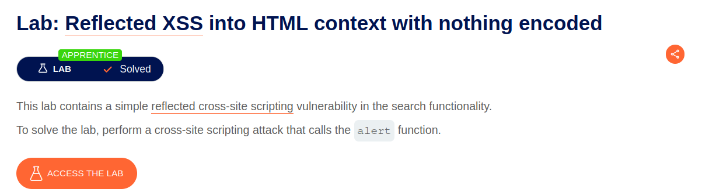
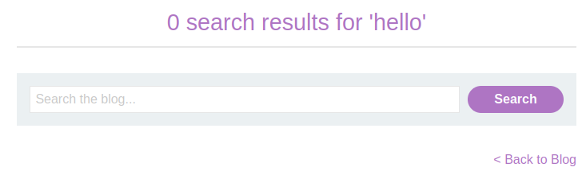
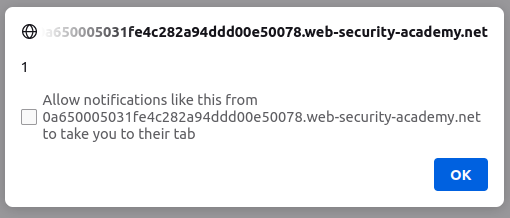

# Reflected XSS into HTML context with nothing encoded

## Lab Description :

## Solution :
We straightaway see a search functionality.

The application echoes the supplied search term in the response to this URL:

``https://0a650005031fe4c282a94ddd00e50078.web-security-academy.net/?search=hello``

Click View Selection Source, shows how our data is being embedded in the page.

``<h1>0 search results for 'hello'</h1>``

### Payload

Enter the following simple XSS payload to trigger an alert!

````

We have thus solved the lab.

#### Visit The Next Page For The Next Level :)
