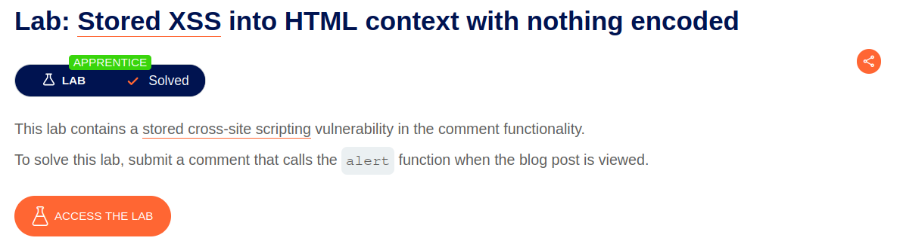
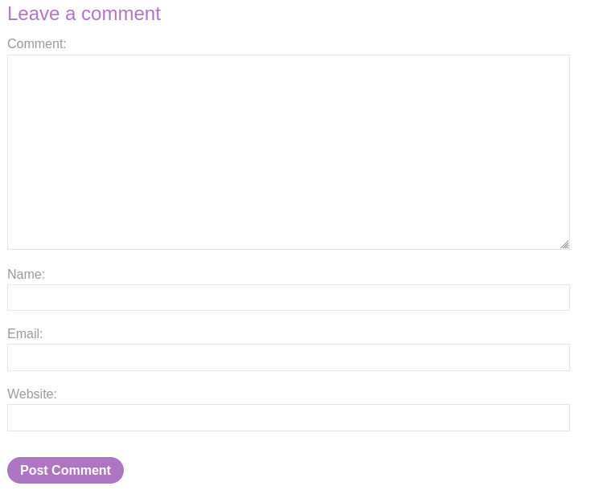
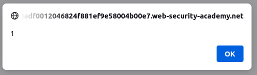
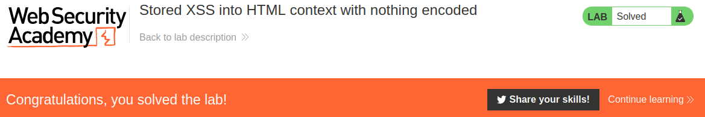

# Stored XSS into HTML context with nothing encoded

## Lab Description :

## Solution :
This time we have a blog website. We have a functionality to post comments.

We can use the following XSS payload in the comment field to perform a stored Xss attack.

````

Now each time when the page containing the comment is reloaded, it triggers an alert.

Thus the lab is solved.

#### Visit The Next Page For The Next Level :)
