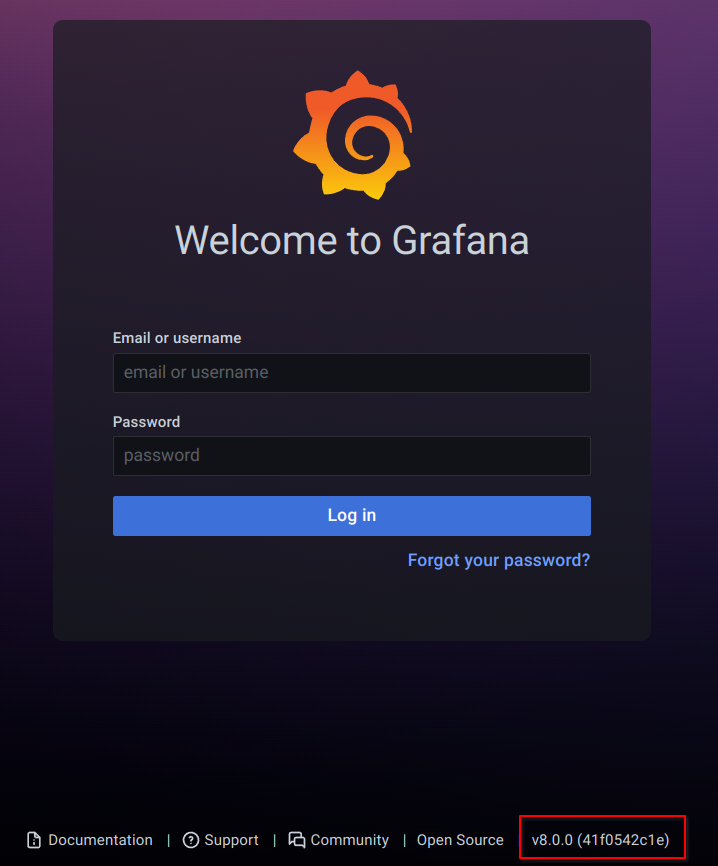

# VulnLab - Data Writeup


Data is an easy Linux machine from VulnLab that starts with a Grafana path traversal, continues through credential extraction and SSH access, and ends with a Docker misconfiguration that leads to root. The box is simple in concept, but it neatly combines web exploitation, password cracking, and container escape style privilege escalation.

## Summary

The target exposed only SSH and Grafana on port 3000. Grafana was running an older vulnerable version, and unauthenticated path traversal made it possible to read local files from the service account’s perspective.

Reading the Grafana database revealed hashed credentials for `boris@data.vl` and `admin@localhost`. After converting the hashes into a format suitable for cracking, I recovered Boris’s password and used it to SSH into the machine.

Once on the box as Boris, local enumeration showed that `sudo` allowed `docker exec` as root. That meant I could jump into a privileged container, mount the host filesystem, and take full control of the system.

## Enumeration

The first scan showed a very small attack surface: SSH on port 22 and Grafana on port 3000.

```bash
rustscan -a 10.10.73.205
```

With only Grafana available, the web service became the obvious place to look for an entry point. The version was visible in the interface and was old enough to match a known unauthenticated traversal issue.

## Grafana Traversal



Grafana was running version 8.0.0, which is vulnerable to CVE-2021-43798. That vulnerability allows unauthenticated path traversal, so I tested it by trying to read `/etc/passwd`.

```bash
go run exploit.go --target http://10.10.115.151:3000 -file /etc/passwd
```

The exploit worked and confirmed that arbitrary files were readable. That immediately made two files interesting:

- `/etc/grafana/grafana.ini`
- `/var/lib/grafana/grafana.db`

The config file mostly contained defaults, but the database held the useful credentials.

## Credential Extraction

I dumped the Grafana SQLite database and opened it in a SQLite browser. The user table contained hashes for:

- `boris@data.vl`
- `admin@localhost`

Those hashes were not directly usable with hashcat, so I converted them into a supported format first.

```bash
python3 grafana2hashcat.py -o ../grafana.hash ../hash.list
hashcat -m 10900 grafana.hash wordlist.txt
```

That cracked Boris’s password successfully. With valid credentials in hand, SSH access became possible.

## User Access

I used Boris’s password to SSH into the host and confirmed shell access. From there, user-level enumeration and LinPEAS showed the real privilege escalation path.

```bash
ssh boris@10.10.73.205
```

The user flag was retrieved at this stage, and the system proved to be vulnerable to a Docker-based root escalation.

## Root Escalation

`sudo -l` showed that Boris could run `docker exec` as root without a password.

```bash
sudo -l
```

The allowed command was the key to full compromise:

```text
(root) NOPASSWD: /snap/bin/docker exec *
```

That meant I could interact with a running container as root. After identifying the container ID from process information, I launched an interactive root shell inside the container.

```bash
sudo docker exec --privileged -it <container_id> -u 0 bash
```

Once inside, I mounted the host’s root filesystem from `/dev/xvda1`.

```bash
mkdir /mnt/test
mount /dev/xvda1 /mnt/test
```

That exposed the controller filesystem, letting me read the root flag and modify `/root/.ssh/authorized_keys` for persistence.

## Attack Path

- Identify Grafana on port 3000.
- Exploit CVE-2021-43798 for unauthenticated file read.
- Dump the Grafana SQLite database.
- Crack Boris’s password hash.
- SSH in as Boris.
- Find sudo permission for `docker exec`.
- Enter a container as root.
- Mount the host filesystem.
- Read the root flag and gain persistence.
