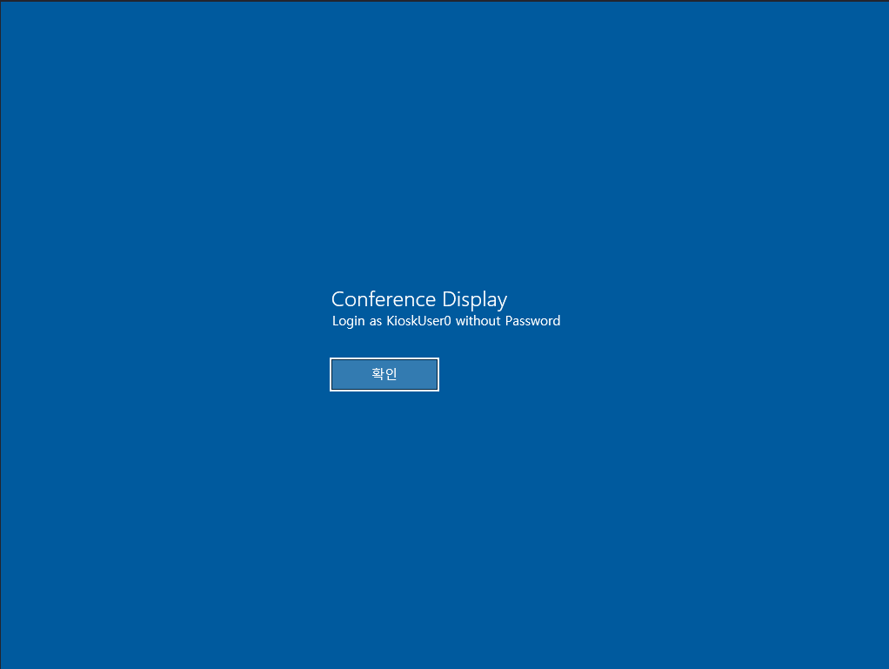
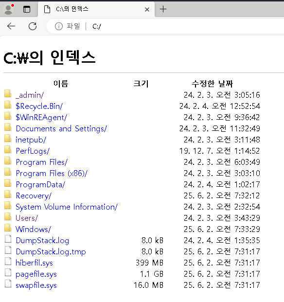
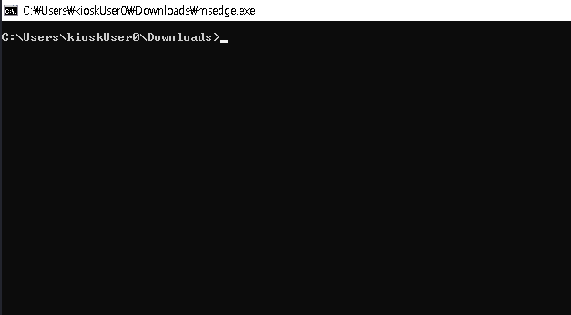
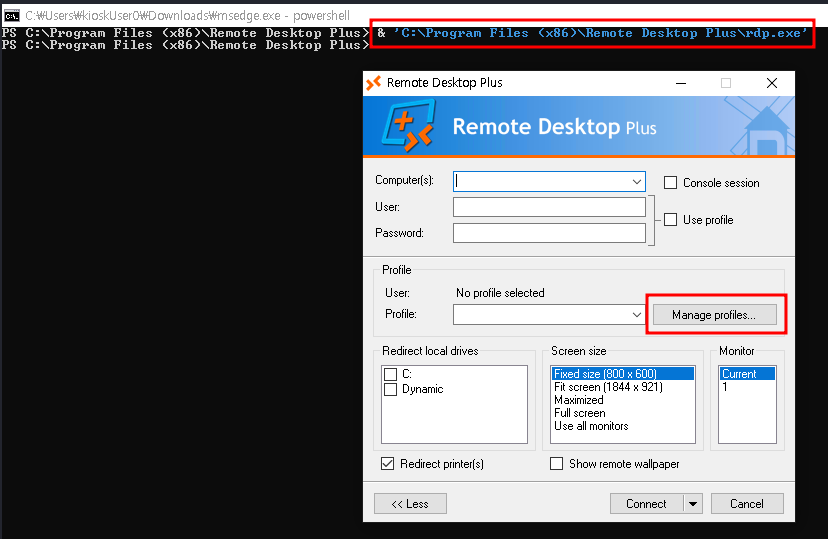
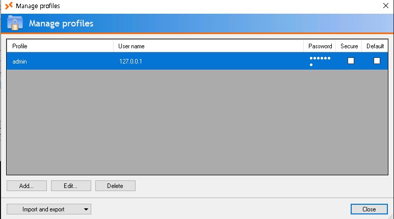
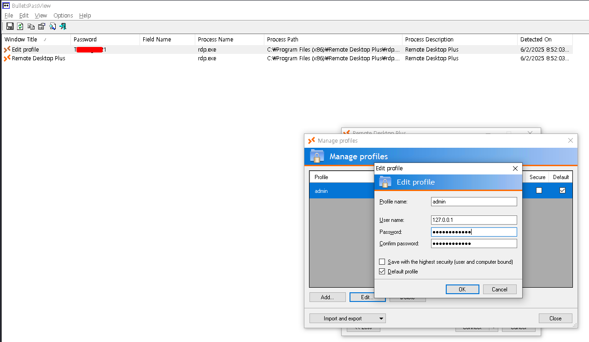
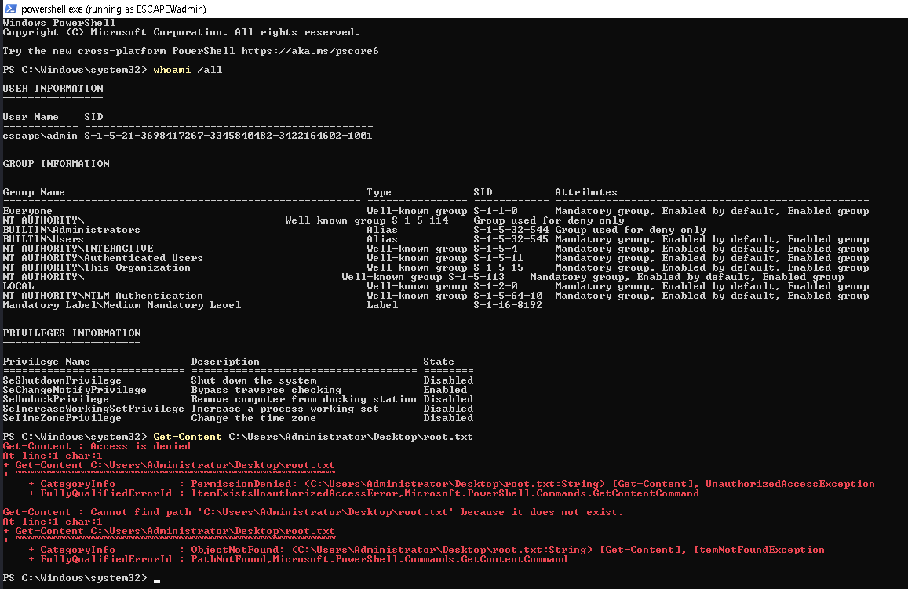

# VulnLab - VulnEscape Writeup


VulnEscape is an Easy Windows lab centered on kiosk-style access, browser restriction bypass, and a final privilege jump through a local admin account. The flow is: connect by RDP, escape the kiosk browser, recover credentials from Remote Desktop Plus, use them to run as admin, and then elevate to a high-integrity shell.  

## Reconnaissance

The only exposed service was RDP on port 3389, and the host identified itself as `ESCAPE` / `Escape` running Windows 10.0.19041. That strongly suggested a locked-down desktop environment rather than a typical server box.  

```bash
nmap -sV -p 3389 <IP>
xfreerdp3 /v:<IP> /sec:'nla:off'
```



## Initial Access

Connecting over RDP showed a message about using `KioskUser0` without a password, and the confirm button was in Korean. After clicking through, I logged in as `KioskUser0` and found that the system was running `msedge.exe` as part of the kiosk setup.  

Using `ALT+TAB` showed that killing the browser would just relaunch the same restricted view, so the goal was to work around the kiosk instead of trying to break it directly.  


## Browser Escape

I opened the Windows start menu and launched another copy of `msedge` myself. That instance exposed the onboarding flow in Korean, which I clicked through until I could reach a normal browsing context.  

From there, I navigated to `file:///C:\` and started browsing the filesystem. That let me grab the first flag from the Desktop.  



## Shell Access

To get a shell, I browsed to `C:\Windows\System32` and downloaded `cmd.exe`. Running it directly failed, so I renamed the binary to `msedge.exe`, which allowed it to execute successfully.  



That gave me a way to interact with the system more freely and continue local enumeration.  

## Credential Recovery

On the root of the file system there’s an interesting folder called _admin that contains credentials for Remote Desktop Plus, but the password for admin is encrypted.

```text
C:_admin\profiles.xml
```

```xml
<?xml version="1.0" encoding="utf-16"?>
<!-- Remote Desktop Plus -->
<Data>
  <Profile>
    <ProfileName>admin</ProfileName>
    <UserName>127.0.0.1</UserName>
    <Password>JW<REDACTED>Wc=</Password>
    <Secure>False</Secure>
  </Profile>
</Data>  
```
I can start the application in C:\Program Files (x86)\Remote Desktop Plus\rdp.exe and import the profiles.xml after copying it to the users Downloads directory.



I imported the profile into the Remote Desktop Plus application, but the password was still masked.

 

To recover it, I used BulletsPassView, which can extract passwords from standard Windows text fields. That revealed the `admin` password. 

 

## Admin Access

I used `runas` to start a PowerShell session as `admin`. Checking `whoami /all` showed that this account was part of the `Administrators` group, but the shell was still running at medium integrity.  

That meant I could not yet access the Administrator desktop directly.  



## High Integrity

To finish the box, I launched PowerShell with the `Run as Administrator` verb. After accepting the UAC prompt, I got a full high-integrity administrative shell.  

```powershell
Start-Process -FilePath "powershell" -Verb RunAs
```

From there, I could read the root flag from `C:\Users\Administrator\Desktop\root.txt`.  

## Attack Path

- **Connect by RDP** and enter the kiosk environment as `KioskUser0`.
- **Bypass the kiosk browser** by launching a second `msedge` instance.
- **Browse the filesystem** using `file:///C:\`.
- **Recover Remote Desktop Plus credentials** from `_admin\profiles.xml`.
- **Extract the masked password** with BulletsPassView.
- **Run as admin** with `runas`.
- **Elevate to high integrity** using `Run as Administrator`.
- **Read the final flag** from the Administrator desktop.
